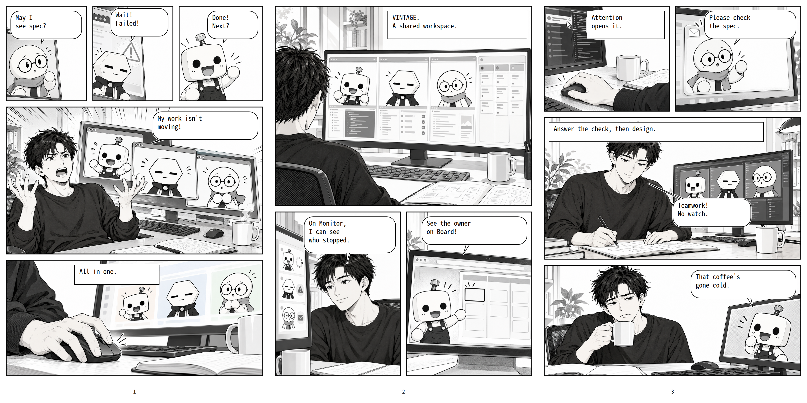

<div align="center">

# VINTAGE - Visual Interface for Terminal Agents

### The terminal workspace built for the age of AI agents.

<br />

> _You don't babysit your agents. They report to you._

<br />

[](LICENSE)
[](https://nodejs.org)
[](https://electronjs.org)
[](./)

<br />

[Get started](#-quick-start) · [See the features](docs/FEATURES.md) · [Architecture](docs/ARCHITECTURE.md) · [日本語](README_JP.md)

<br />
<br />

</div>

---

<br />

<div><video controls src="https://github.com/user-attachments/assets/ec6bb6ae-c658-48bf-9b5b-416ab75839d5" muted="false"></video></div>



<p align="center">
<a href="assets/manga/en/page-01.png">page 1</a> · <a href="assets/manga/en/page-02.png">page 2</a> · <a href="assets/manga/en/page-03.png">page 3</a>
</p>
<br />

---

<br />

<div align="center">

## You're running 5 agents simultaneously.<br />You have no idea what any of them are doing.

</div>

<br />

You open a terminal. Then another. Three more. Each one is running a different agent on a different task. One finishes and sits waiting for input. One crashes silently. Two are still going. Which is which? You're alt-tabbing between windows, scrolling through output, trying to remember which pane you kicked off that refactor in.

**This is not a tooling problem. This is a workflow problem. VINTAGE fixes it.**

<br />

---

<br />

## Features

|     | Feature             | What it does                                                                                                               |
| --- | ------------------- | -------------------------------------------------------------------------------------------------------------------------- |
| ⚡  | **Attention**       | Background terminals that finish, error, or stall fire a notification — one click back to that exact terminal. No hunting. |
| 🔲  | **Space splitting** | Split your workspace horizontally or vertically. Run agents side by side. Each pane independent.                           |
| 🎛  | **Command Palette** | `Ctrl+Shift+P` — jump to any workspace, Space, terminal, or action from a single input.                                    |
| 📡  | **Monitor**         | Live CPU, RAM, and every AI session on the machine — tool in use, context %, quota remaining.                              |
| 🗄  | **Sessions**        | Browse and resume past Claude Code / Codex / Grok / Antigravity conversations. Search, pin, read, resume.                  |
| 📋  | **Board**           | A Kanban board your agents can write to. Drop tasks in. Agents update cards, add subtasks, close tickets. All local.       |
| 🎨  | **Themes**          | Vintage · Graphite · Ocean · Grove · Iris · Ember — independent light/dark palettes, full JSON import/export.              |

<br />

### Status at a glance

| State                                  | Display               |
| :------------------------------------- | :-------------------- |
| Normal terminal                        | `>_`                  |
| Agent thinking or running              | Rotating spinner      |
| Input needed                           | Message icon          |
| Waiting                                | Clock icon            |
| Completed                              | Check icon            |
| Warning or failure                     | Warning or error icon |
| Agent detected, idle or status unknown | Robot icon            |

Drag the right edge of the left sidebar to resize it. The width is saved across restarts. Gary crawls over little stairs and stops for an apple above the sidebar footer, with new positions and timing on each round trip. Toggle Gary in **Settings → Appearance → Sidebar Gary**. Reduced motion keeps the scene still.

Status icons appear in Space tabs and sidebar rows. Hover over an icon for its status label. Spinners remain still when reduced motion is enabled.

Sidebar Space rows also show colored agent badges (such as CD for Codex and OC for OpenCode), matching Monitor Sessions. Split panes with different agents show one badge per agent type, including agents waiting for input. Badge outlines pulse while working, stay emphasized while waiting for input, and fade on completion. Hover for the agent name and status; reduced motion disables the pulse.

<br />

---

<br />

## 🚀 Quick start

```bash
pnpm install
pnpm dev
```

Done. VINTAGE opens with `Space 1` and `Terminal 1` in your home directory.

**`Ctrl+Shift+P`** — command palette. One input for workspaces, Spaces, terminals, and actions.

```bash
# Production build
pnpm build && pnpm start

# Package for distribution
pnpm run dist:linux   # → AppImage, .deb
pnpm run dist:mac     # → .dmg, .zip
pnpm run dist:win     # → NSIS installer
```

<br />

---

<br />

## Requirements

- **Node.js** 24+
- **pnpm** 10.33.2+
- **C/C++ build tools** — compiler + `make` + Python (for `node-pty` on Linux)

<br />

---

<br />

## Docs

- [Features and screen guide](docs/FEATURES.md)
- [Architecture](docs/ARCHITECTURE.md)
- [Board, storage and Skill distribution](docs/KANBAN.md)
- [日本語 README](README_JP.md) · [日本語: 機能と画面のガイド](docs/FEATURES_JP.md)

<br />

---

<br />

<div align="center">

**Apache 2.0** — [LICENSE](LICENSE) · [NOTICE.md](NOTICE.md)

<br />

_The right terminal calls you back._

</div>
