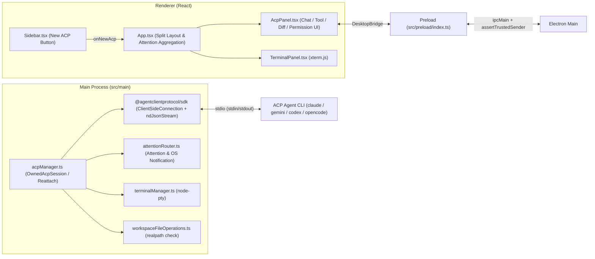

# VINTAGE ACP (Agent Client Protocol) 対応設計書

VINTAGE（Visual Interface for Terminal Agents）を **ACP (Agent Client Protocol) Client** に対応させ、既存の `TerminalPanel` とまったく同じ感覚で Space 内に分割・並走できるようにするアーキテクチャ設計です。

> [!IMPORTANT]
> **ユーザー体験（UX）のゴール**
> - **VINTAGE は ACP Client（ホスト）として動作**する。
> - **左サイドバー（`Sidebar.tsx`）の `New space` の直下に `New ACP` ボタンを追加**する。
> - `New ACP` を押すと、現在開いている Space の中央エリア（Center）にある **アクティブな Terminal（または現在のレイアウト）の右隣に水平分割（`axis: "horizontal"`, `ratio: 0.5`）で `ACP 1` ペイン（`AcpPanel`）が開く**（Space がまだない場合は ACP ペインを持つ新しい Space を作成）。
> - `AcpPanel` は `TerminalPanel` と同じヘッダー構造（ダブルクリックでのリネーム、Monitor モード切替、Attention バッジ、閉じる `×` ボタン、`Ctrl+W` / `Ctrl+Shift+W` で閉じる操作、リロード後のセッション再接続）を持つ。

---

## 1. 画面・操作フローの設計（Terminal と同等の Pane 体験）

### 1.1. 左サイドバー (`src/renderer/components/Sidebar.tsx`)

現在、[`Sidebar.tsx` L417-431](file:///home/masato/Agentic/new_vintage/src/renderer/components/Sidebar.tsx#L417-L431) には `New space` と `Open folder` が並んでいます。この `New space` のすぐ下に **`New ACP`** ボタンを追加します。

```tsx
// src/renderer/components/Sidebar.tsx (L417付近)
<div className="space-y-1 px-2 py-3">
  <Button
    className="w-full justify-start"
    variant="ghost"
    disabled={!canCreateSpace}
    onClick={onNewSpace}
  >
    <Plus aria-hidden="true" className="size-4 text-foreground" />
    New space
  </Button>
  <Button
    className="w-full justify-start"
    variant="ghost"
    disabled={!canCreateAcp}
    onClick={onNewAcp}
  >
    <Bot aria-hidden="true" className="size-4 text-foreground" />
    New ACP
  </Button>
  <Button className="w-full justify-start" variant="ghost" onClick={onOpenWorkspace}>
    <FolderOpen aria-hidden="true" className="size-4 text-foreground" />
    Open folder
  </Button>
</div>
```

### 1.2. `New ACP` 押下時の分割ロジック (`src/renderer/App.tsx`)

[`App.tsx`](file:///home/masato/Agentic/new_vintage/src/renderer/App.tsx) の `split("right")`（L805）および `openFile`（L902）の分割ツリー更新パターンを踏襲し、`addAcpPane()` を実装します。

```ts
// src/renderer/App.tsx
type AcpPane = Extract<WorkspacePaneSnapshot, { kind: "acp" }>;

const addAcpPane = (agentId?: AcpAgentId) =>
  update((workspace) => {
    if (!workspace.available) return workspace;
    const tab = workspace.tabs.find((item) => item.id === workspace.activeTabId);

    // 1. もし現在のWorkspaceにSpaceが1つも無い場合は、ACPペインを持つ新しいSpaceを作成
    if (!tab) {
      const pane: AcpPane = {
        id: id(),
        title: "ACP 1",
        kind: "acp",
        ...(agentId ? { agentId } : {}),
      };
      const nextTab: Tab = {
        id: id(),
        title: nextNumberedTitle("Space", workspace.tabs.map((t) => t.title)),
        panes: [pane],
        layout: { type: "pane", paneId: pane.id },
        activePaneId: pane.id,
      };
      return { ...workspace, tabs: [...workspace.tabs, nextTab], activeTabId: nextTab.id };
    }

    // 2. 上限チェック（MAX_PANES = 64, MAX_LAYOUT_DEPTH = 8）
    if (tab.panes.length >= MAX_PANES || layoutDepth(tab.layout) >= MAX_LAYOUT_DEPTH) {
      setWorkspaceActionError(
        "This Space has reached its pane or layout depth limit. Close a pane or open ACP in another Space.",
      );
      return workspace;
    }

    // 3. "ACP 1", "ACP 2"... の連番タイトルを採番
    const pane: AcpPane = {
      id: id(),
      title: nextNumberedTitle("ACP", tab.panes.map((item) => item.title)),
      kind: "acp",
      ...(agentId ? { agentId } : {}),
    };

    // 4. アクティブなPane（Terminal等）の右隣に horizontal split (ratio: 0.5) で挿入
    //    アクティブPaneの深さが上限に達している場合は openFile と同様にルート全体を右分割
    const layout =
      splitPaneLayout(tab.layout, tab.activePaneId, pane.id, "horizontal") ?? {
        type: "split",
        splitId: id(),
        axis: "horizontal",
        ratio: 0.5,
        first: tab.layout,
        second: { type: "pane", paneId: pane.id },
      };

    return {
      ...workspace,
      tabs: workspace.tabs.map((item) =>
        item.id === tab.id
          ? { ...item, panes: [...item.panes, pane], layout, activePaneId: pane.id }
          : item,
      ),
    };
  });
```

### 1.3. Center エリアでの見え方とショートカット・コマンドパレット連携

```text
+-------------------+---------------------------------------------------+------------------+
| Workspace         | [Space 1] [+]                                     | SidePane         |
|                   +------------------------+--------------------------+ (Files / Review  |
| + New space       | >_ Terminal 1  Monitor | [Bot] ACP 1 (Claude) [x] |  Notes / Board   |
| [Bot] New ACP     +------------------------+--------------------------+  Monitor /       |
| [Folder] Open...  | $ pnpm dev             | [You]                    |  Sessions /      |
|                   |                        | Fix failing tests        |  Browser)        |
| Local             |                        |                          |                  |
|   Home            |                        | [Claude ACP]             |                  |
| Projects          |                        | ▾ Thought (1.2s)         |                  |
|   new_vintage     |                        | ▸ Read src/main/index.ts |                  |
|     ● Space 1 [CC]|                        |                          |                  |
|                   |                        | +----------------------+ |                  |
|                   |                        | | Permission required  | |                  |
|                   |                        | | Run: pnpm test       | |                  |
|                   |                        | | [Allow] [Reject]     | |                  |
|                   |                        | +----------------------+ |                  |
|                   |                        |                          |                  |
|                   |                        | [ Ask ACP agent...  [>] ]|                  |
+-------------------+------------------------+--------------------------+------------------+
```

- **PaneView の分岐 ([`src/renderer/App.tsx` L369-439](file:///home/masato/Agentic/new_vintage/src/renderer/App.tsx#L369-L439))**:
  - `pane.kind === "terminal"` → `<TerminalPanel />`
  - `pane.kind === "acp"` → `<AcpPanel />`（新規）
  - `pane.kind === "file"` → `<FileViewer />`
- **同じショートカットと操作性**:
  - コマンドパレット (`Ctrl+Shift+P`) に **`New ACP`**（Suggested アクション）を追加。
  - キーボードショートカット (`ShortcutAction`) に `"new-acp"`（例：既定 `Ctrl+Shift+A`、Settings → Shortcuts で変更可）を追加。
  - `ResizeHandle` による Terminal と ACP ペイン間のドラッグ幅調整、絶対配置（`positionedLayout`）によるリサイズ時のマウント維持は既存の仕組みがそのまま機能します。

---

## 2. 全体アーキテクチャとプロセス責務

VINTAGE の境界検査（[`scripts/check-boundaries.mjs`](file:///home/masato/Agentic/new_vintage/scripts/check-boundaries.mjs)）に従い、ACP エージェントのサブプロセス生成・stdio JSON-RPC 2.0 通信・ファイル/PTY ブリッジはすべて **Main プロセス**で行います。



---

## 3. データモデル・型定義・永続化の変更箇所

### 3.1. [`src/shared/desktop.ts`](file:///home/masato/Agentic/new_vintage/src/shared/desktop.ts) と [`src/main/workspaceState.ts`](file:///home/masato/Agentic/new_vintage/src/main/workspaceState.ts)

1. **`WorkspacePaneSnapshot` に `kind: "acp"` を追加**:
   ```ts
   // src/shared/desktop.ts
   export type AcpAgentId = "claude" | "codex" | "gemini" | "opencode" | "custom";

   export type WorkspacePaneSnapshot =
     | { id: string; title: string; kind: "terminal" }
     | { id: string; title: string; kind: "file"; path: string; targetLine?: number | undefined }
     | { id: string; title: string; kind: "acp"; agentId?: AcpAgentId | undefined };
   ```
2. **`workspaceState.ts` の `parsePane()` を拡張**:
   - [`src/main/workspaceState.ts` L49-66](file:///home/masato/Agentic/new_vintage/src/main/workspaceState.ts#L49-L66) の `parsePane` で `value.kind === "acp"` を許可します。これにより、VINTAGE を再起動しても Space 内の「左に Terminal 1、右に ACP 1」という分割レイアウトが `workspace-state.json` から自動復元されます。

### 3.2. [`src/shared/acp.ts`](file:///home/masato/Agentic/new_vintage/src/shared/acp.ts)（新規作成：プロバイダ設定とセッション型）

ACP プロバイダ（プリセット＋カスタム追加可能なエージェント定義）と、JSON-RPC 2.0 セッション状態を繋ぐ共有型を定義します。

```ts
import type { AcpAgentId, TerminalMonitorMode } from "./desktop.js";

export type AcpPermissionPolicy = "ask" | "auto_edit" | "auto_all";

export interface AcpAgentProfile {
  id: string;                 // "claude" | "gemini" | "codex" | "opencode" | "antigravity" | "custom-<uuid>"
  name: string;               // 表示名 (例: "Claude Code", "My Custom Agent")
  badge: string;              // 2文字バッジ (例: "CC", "GM", "CD", "OC", "AG", "AC")
  builtin: boolean;           // プリセットかユーザー追加か
  executable: string;         // 空文字なら自動検出 (PATH / ~/.local/bin / nvm / bun 等)、または絶対パス
  defaultCandidates: string[];// 自動検出時の候補バイナリ名 (例: ["claude-code-acp", "claude"])
  args: string[];             // 起動引数配列 (例: ["--acp"])
  permissionPolicy: AcpPermissionPolicy;
}

export interface AcpSettings {
  defaultProfileId: string;
  profiles: AcpAgentProfile[];
}

export interface AcpProbeResult {
  ok: boolean;
  resolvedPath: string | null;
  protocolVersion?: number;
  agentInfo?: { name?: string; version?: string };
  message: string;
}

export interface AcpCreateOptions {
  workspaceId: string;
  paneId: string;
  profileId?: string;
  tabTitle?: string;
  paneTitle?: string;
}
```

export interface AcpToolCallItem {
  toolCallId: string;
  title: string;
  kind?: "read" | "edit" | "execute" | "search" | "other";
  status: "pending" | "in_progress" | "completed" | "failed";
  locations?: Array<{ path: string; line?: number }>;
  content?: Array<
    | { type: "text"; text: string }
    | { type: "diff"; path: string; oldText?: string; newText: string }
    | { type: "terminal"; terminalId: string; command?: string; output?: string; exitCode?: number | null }
  >;
}

export interface AcpPermissionOption {
  optionId: string;
  name: string;
  kind: "allow_once" | "allow_always" | "reject_once" | "reject_always";
}

export interface AcpPermissionRequest {
  requestId: string;
  sessionId: string;
  toolCall: AcpToolCallItem;
  options: AcpPermissionOption[];
}

export interface AcpConversationMessage {
  id: string;
  role: "user" | "assistant";
  text: string;
  thought?: string;
  toolCalls?: AcpToolCallItem[];
  createdAt: number;
  streaming?: boolean;
}

export interface AcpSessionSnapshot {
  id: string; // VINTAGE 内部セッションID
  acpSessionId: string | null; // エージェント側の sessionId
  paneId: string;
  workspaceId: string;
  cwd: string;
  agentId: AcpAgentId;
  agentCommand: string;
  status: "starting" | "ready" | "running" | "waiting_permission" | "stopped" | "error";
  errorMessage?: string;
  monitorMode: TerminalMonitorMode;
  messages: AcpConversationMessage[];
  pendingPermission: AcpPermissionRequest | null;
  reattached?: boolean;
}

export type AcpEvent =
  | { type: "session.state"; sessionId: string; snapshot: AcpSessionSnapshot }
  | { type: "message.delta"; sessionId: string; messageId: string; field: "text" | "thought"; delta: string }
  | { type: "tool.upsert"; sessionId: string; messageId: string; toolCall: AcpToolCallItem }
  | { type: "permission.requested"; sessionId: string; request: AcpPermissionRequest }
  | { type: "permission.resolved"; sessionId: string; requestId: string }
  | { type: "session.error"; sessionId: string; message: string }
  | { type: "session.exit"; sessionId: string; exitCode: number | null };
```

### 3.3. `DesktopChannels` と `DesktopBridge` の追加チャンネル

[`src/shared/desktop.ts`](file:///home/masato/Agentic/new_vintage/src/shared/desktop.ts) と [`src/preload/index.ts`](file:///home/masato/Agentic/new_vintage/src/preload/index.ts) に、`terminal:*` と対称的な IPC メソッドを追加します。

| チャンネル名 | Bridge メソッド | 役割 |
| :--- | :--- | :--- |
| `acp:create` | `createAcpSession(options)` | ACP プロセス起動（またはリロード後の既存セッション再接続）と `initialize` → `session/new` 実行 |
| `acp:ready` | `readyAcpSession(sessionId)` | Renderer 購読完了通知（保留イベントのフラッシュ） |
| `acp:prompt` | `sendAcpPrompt(sessionId, text)` | `session/prompt` の送信 |
| `acp:cancel` | `cancelAcpPrompt(sessionId)` | `session/cancel` Notification の送信 |
| `acp:permission` | `respondAcpPermission(sessionId, requestId, optionId)` | `session/request_permission` の JSON-RPC Response 返却 |
| `acp:set-active` | `setAcpActive(sessionId, active)` | フォーカス状態の通知 |
| `acp:set-monitor-mode` | `setAcpMonitorMode(sessionId, mode)` | ペインごとの通知モード保存・変更 |
| `acp:close` | `closeAcpSession(sessionId)` | ペインを閉じた際のサブプロセス終了とクリーンアップ |
| `acp:event` | `onAcpEvent(listener)` | Main → Renderer へのストリーミングイベント配信 |

---

## 4. Main プロセス (`src/main/`) の設計詳細（公式 `@agentclientprotocol/sdk` 採用）

### 4.1. プロトコル層は独自実装せず公式 `@agentclientprotocol/sdk` を使用

JSON-RPC 2.0 や NDJSON ストリームのフレーミング・スキーマ検証を自前で実装せず、**ACP 公式の TypeScript SDK (`@agentclientprotocol/sdk`)** を `dependencies` に導入して使用します。

- `child_process.spawn(command, args, { cwd, env, stdio: ["pipe", "pipe", "pipe"], shell: false })` でエージェントプロセスを起動。
- Node.js 標準の `Writable.toWeb(child.stdin)` と `Readable.toWeb(child.stdout)` を公式 SDK の **`acp.ndJsonStream(input, output)`** に接続。
- 公式 SDK の **`new acp.ClientSideConnection((agent) => clientHandlers, stream)`** を使い、`initialize`, `newSession`, `prompt`, `cancel`, `setSessionConfigOption`（モデルや Reasoning 強度の動的変更）を型安全に呼び出します。

```ts
import * as acp from "@agentclientprotocol/sdk";
import { spawn } from "node:child_process";
import { Readable, Writable } from "node:stream";

const child = spawn(command.file, command.args, {
  cwd,
  env: command.env,
  stdio: ["pipe", "pipe", "pipe"],
  shell: false,
});

const stream = acp.ndJsonStream(
  Writable.toWeb(child.stdin),
  Readable.toWeb(child.stdout),
);

const connection = new acp.ClientSideConnection(
  (_agent) => ({
    sessionUpdate: async (params) => this.handleSessionUpdate(session, params),
    requestPermission: async (params) => this.handleRequestPermission(session, params),
    readTextFile: async (params) => this.handleReadTextFile(session, params),
    writeTextFile: async (params) => this.handleWriteTextFile(session, params),
    createTerminal: async (params) => this.handleCreateTerminal(session, params),
    terminalOutput: async (params) => this.handleTerminalOutput(session, params),
    waitForTerminalExit: async (params) => this.handleWaitForTerminalExit(session, params),
    killTerminal: async (params) => this.handleKillTerminal(session, params),
    releaseTerminal: async (params) => this.handleReleaseTerminal(session, params),
  }),
  stream,
);
```

### 4.2. `src/main/acpManager.ts`（セッション・ライフサイクルと VINTAGE ブリッジ）

[`terminalManager.ts`](file:///home/masato/Agentic/new_vintage/src/main/terminalManager.ts) と完全に同じライフサイクル管理を行います：

1. **リロード耐性（Detached Session Reattach）**:
   - `observeOwner(event.sender)` で WebContents の `did-start-navigation` / `render-process-gone` を監視。
   - 画面リロード時は ACP サブプロセスを維持したまま `attached = false` にし、再マウント時に同じ `paneId` で `AcpSessionSnapshot`（これまでの会話履歴・ツール実行状態・保留中の Permission 要求）をそのまま返して `reconnected` 表示にします。
2. **ACP Agent → VINTAGE 機能のブリッジ**:
   - **`fs/read_text_file` / `fs/write_text_file`**:
     - [`workspaceFileOperations.ts`](file:///home/masato/Agentic/new_vintage/src/main/workspaceFileOperations.ts) のパス境界検証（`realpath` が当該 Workspace 配下であること、シンボリックリンク逸脱がないこと）を通過したもののみ実行。
   - **`terminal/create` / `terminal/output` / `terminal/wait_for_exit` / `terminal/kill` / `terminal/release`**:
     - エージェントがコマンド実行を要求した際、Main 内で `node-pty`（または `child_process`）を生成し、出力をリアルタイムに `AcpToolCallItem` へストリーミングします。
   - **`session/request_permission`**:
     - エージェントからツール実行承認要求が来た時点で、その Request Promise を保留して Renderer の `AcpPanel` に承認カードを表示。
     - 同時に `AttentionRouter` を **`waiting_input` (Attention Level 3, `userActionRequired: true`, `reason: "input_request"`)** に遷移させます。これにより、別 Space を見ていても **Attention トーストと OS 通知**が飛び、クリック一発でその ACP ペインへ戻れます。
3. **AttentionRouter & Monitor 連携**:
   - `AcpPanel` も `onTerminalAttention` イベント（または共通の `paneId` ベース Attention 更新）を発火するため、Space タブのドット、左サイドバーの Attention 一覧、エージェントバッジ（`CC`, `CD`, `OC`, `AG` 等）が既存の `TerminalPanel` とまったく同じように点灯・点滅します。

---

## 5. `AcpPanel.tsx` の UI 設計（VINTAGE ネイティブ実装 & 3カラム Model Popover）

### 5.1. チャット UI の実装方針（外部 UI ライブラリ不使用・VINTAGE ネイティブ構成）

`@assistant-ui/react` 等の外部チャット UI ライブラリは導入せず、VINTAGE 既存の [`SessionConversation.tsx`](file:///home/masato/Agentic/new_vintage/src/renderer/components/SessionConversation.tsx)・[`MarkdownPreview.tsx`](file:///home/masato/Agentic/new_vintage/src/renderer/components/MarkdownPreview.tsx)（Mermaid 図・相対ファイルリンク連携）・[`ReviewPane.tsx`](file:///home/masato/Agentic/new_vintage/src/renderer/components/ReviewPane.tsx)（Diff 描画）をベースに **VINTAGE ネイティブコンポーネント**として構築します。
これにより、[`DESIGN.md`](file:///home/masato/Agentic/new_vintage/DESIGN.md) の必須制約（`text-ui-*` タイポグラフィ、Zai Light/Dark を含む6テーマのセマンティックトークン、コンテナの Radius 階層）を100%遵守し、ファイルリンクをクリックして隣の `FileViewer` ペインで開くなどの密な連携を実現します。

#### チャット画面の5大サブコンポーネント
1. **`AcpHeaderBar`（上部ペインバー）**:
   - [`TerminalPanel.tsx`](file:///home/masato/Agentic/new_vintage/src/renderer/components/TerminalPanel.tsx) と同じ `h-8 border-b border-border bg-header px-3`。
   - ペインタイトル（ダブルクリックでリネーム可）、稼働中エージェントと CWD 表示、Attention 状態バッジ、`TerminalMonitorPicker`（Monitor / Mute / Always Notify / Errors Only / Ignore）、新規会話リセットボタン、閉じる `×` ボタン。
2. **`AcpMessageList`（会話ストリーム領域）**:
   - ユーザー発言バブル（`rounded-2xl rounded-tr-sm border border-border bg-selected`）とアシスタントの Markdown 応答（Gfm 表、シンタックス付きコードブロック、Mermaid 図、コピーボタン、ストリーミングキャレット）。
   - スマートオートスクロール（ストリーミング中は自動追従、ユーザーが上へスクロールした際は停止し、下部にフローティングの `↓` ボタンを表示）。
3. **`AcpThoughtBlock`（思考過程アコーディオン）**:
   - `agent_thought_chunk` を `▾ Thought (1.4s)` のようなコンパクトな折りたたみブロック（`text-ui-sm text-foreground-subtle`）で表示。思考完了後は自動で折りたたむ。
4. **`AcpToolCallCard`（ツール実行・インライン Diff・コマンド出力）**:
   - `rounded-xl border border-card-border bg-card p-3`。
   - `read` / `edit` / `execute` / `search` のアイコンとステータス表示。ファイルパスをクリックすると `onOpenFile(path, line)` で VINTAGE の `FileViewer` ペインを開く。
   - ファイル編集時は `--color-diff-added` / `--color-diff-removed` によるインライン Diff、コマンド実行時は `font-mono` の標準出力と終了コードを表示。
5. **`AcpPermissionBanner`（承認リクエスト UI）**:
   - `session/request_permission` 受信時に表示。[`DESIGN.md`](file:///home/masato/Agentic/new_vintage/DESIGN.md#L151-L154) の `--color-interaction-confirmation-surface` / `--color-interaction-confirmation-foreground` を使用し、`Allow once` / `Allow always` / `Reject` ボタンで即座に JSON-RPC Response を返却。

### 5.2. プロバイダー・モデル・Reasoning 3カラム切り替えポップオーバー (`AcpModelPopover`)

プロンプト入力欄（Composer）の右下にあるピルボタン（例：`[◎ GPT-6.2-Sol Low]` / `[✴ Claude Sonnet 4.5 High]`）をクリックすると、Composer の直上に **`bg-popover border border-popover-border rounded-xl shadow-md` の3カラムポップオーバー**が開き、`AcpPanel` 内でいつでもプロバイダー・モデル・推論強度・アクセス権限を切り替えられます。

```text
   +----+-------------------------------+-----------------------+
   | ★  | 🔍 モデルを検索...             | Reasoning     6.2 Sol |
   |----|-------------------------------|-----------------------|
   | ◎ | ◎ GPT-6.2-Sol  ✓           ☆ | Low                 ✓ |
   | ✴ | ◎ GPT-6.2-Astra            ☆ | Medium                |
   | A  | ◎ GPT-6.1 Terra            ☆ | High                  |
   | Z  | ◎ GPT-6.1-Sol              ☆ | Extra High            |
   |    | ◎ GPT-6-Astra              ☆ | Max                   |
   |    | さらに表示                     | Ultra                 |
   |    |                               |-----------------------|
   |    |                               | Access Policy         |
   |    |                               | Standard            > |
   +----+-------------------------------+-----------------------+
   | [Standard | ⚡ Fast]                       🚫 フルアクセス ^ |
   +------------------------------------------------------------+
  +--------------------------------------------------------------+
  | 何でも聞いてください...                                       |
  |                                                              |
  | 📎                                  [ ◎ 6.2 Sol Low ]     [↑]|
  +--------------------------------------------------------------+
```

1. **左カラム（お気に入り `★` ＋ プロバイダーアイコンレール）**:
   - `★`（ピン留めしたお気に入りモデル一覧）と、登録済みプロバイダー（Codex / OpenAI、Claude Code、Antigravity / Gemini、OpenCode / ZCode、およびカスタム追加プロバイダー）のアイコンが縦に並びます。
   - プロバイダーを切り替えると、該当プロバイダーのモデル一覧を中央カラムに表示し、選択確定時にそのプロバイダーの ACP セッションへシームレスに切り替えます。
2. **中央カラム（モデル検索 ＋ モデル選択リスト ＋ お気に入り `☆`）**:
   - 上部の検索ボックス（`モデルを検索...`）でインクリメンタル絞り込み。
   - ACP `session/new` の `configOptions`（`category: "model"`）から動的に取得したモデル一覧＋プロバイダー既定モデルリストを表示。
   - モデル選択時に ACP `session/set_config_option` を送信してセッションのモデルを即時変更。右端の `☆` でお気に入り登録（`localStorage` 保存）。
3. **右カラム（Reasoning 強度 ＋ Access / 実行モード設定）**:
   - **Reasoning (`Low` / `Medium` / `High` / `Extra High` / `Max` / `Ultra`)**: 選択中のモデルがサポートする推論強度を表示し、ACP `session/set_config_option`（`category: "reasoning"` / `"effort"`）で反映。
   - **下部フッターバー**:
     - 左：`Standard` / `⚡ Fast` モード切替トグル。
     - 右：権限モード（`Ask` / `Standard` / `フルアクセス (Auto-approve)`）をワンクリックで切り替え。

---

## 6. プロバイダ・コマンドの設定設計（プリセット自動検出 ＋ Settings からの追加・編集）

ACP エージェントはツールごとに起動バイナリや引数が異なるため、**「組み込みプリセットの自動検出」** と **「Settings（設定画面）からの追加・編集・接続テスト」** の2段構えで管理します（保存先：`userData/acp-settings.json`、Main プロセス所有・権限 `0600`）。

### 6.1. 組み込みプリセットと自動検出 (`src/main/acpSettings.ts`)

[`src/main/sessionCommand.ts`](file:///home/masato/Agentic/new_vintage/src/main/sessionCommand.ts) の `resolveSessionExecutable` と同じ探索パス（`PATH`, `~/.local/bin`, `~/.nvm`, `~/.bun`, `~/.volta`, `~/.cargo/bin`, `/opt/homebrew/bin`, Windows の npm / WinGet 等）を使って自動検出します。

| ID            | 名前                 | バッジ | 自動検出候補 (`defaultCandidates`)             | 既定の引数 (`args`) | 備考                                                                                                |
| :------------ | :------------------- | :----- | :--------------------------------------------- | :------------------ | :-------------------------------------------------------------------------------------------------- |
| `codex`       | Codex                | `CD`   | `["codex-acp"]`                                | `[]`                | `@agentclientprotocol/codex-acp` を同梱し自動解決                                                   |
| `claude`      | Claude Code          | `CC`   | `["claude-agent-acp", "claude-code-acp"]`      | `[]`                | `@agentclientprotocol/claude-agent-acp` を同梱し自動解決。`~/.claude/settings.json` のカスタムモデルも即時反映 |
| `antigravity` | Antigravity / Gemini | `AG`   | `["agy", "gemini"]`                            | `["acp"]`           | ローカル CLI を自動検出                                                                             |
| `opencode`    | OpenCode             | `OC`   | `["opencode2", "opencode"]`                    | `["acp"]`           | OpenCode Go モデル（`https://opencode.ai/zen/go/v1/models` / キャッシュ）のみに自動絞り込み         |
| `zai`         | Z.ai                 | `ZA`   | `["opencode2", "opencode"]`                    | `["acp"]`           | OpenCode 経由の `zai-coding-plan/*`（または `zai/*`）モデルを専用プロバイダーとして分離             |

> [!NOTE]
> **実装済みの主な拡張機能**
> - **プロバイダー別常駐ランタイム**: 1 つの ACP ペイン内でプロバイダーを切り替えても既存プロセスを保持し、戻した際の再ハンドシェイクを省略。
> - **混在会話のメッセージ単位帰属**: 各アシスタントメッセージに生成時の `profileId` / `profileName` / `profileBadge` / `modelName` を刻印して保持。
> - **Composer 補完・マルチモーダル**: `$`（Skills）・`/`（組み込み＋エージェントスラッシュコマンド）・`@`（ワークスペース内ファイル）の補完メニュー、画像ペースト／ドロップ送信、`Shift+Tab` での Mode 切替。
> - **リッチ表示と WorkLog**: t3code を参考にした 1 行折りたたみ式のツール WorkLog、Plan カード、応答経過時間・コンテキスト使用量バッジ、ローカル／エージェント生成画像のインライン表示＆拡大ライトボックス、サンドボックス `<iframe>` による HTML / SVG プレビュー。
> - **Sessions 連携**: 右ペインの `Sessions` から **ACP** ボタンで過去セッションの履歴表示＋`session/resume` / `session/load` 再開に対応。

### 6.2. 設定画面 (`Settings → ACP Agents`) でできること

[`SettingsDialog.tsx`](file:///home/masato/Agentic/new_vintage/src/renderer/components/SettingsDialog.tsx) に **ACP Agents** セクション（または `Integrations` 内のカード）を追加します。

1. **Default Agent for "New ACP"**:
   - 左ペインの `New ACP` を押したときに起動する既定プロファイルを選択。
2. **各プロファイルの Executable / Arguments 編集**:
   - **Executable path**: 空欄なら自動検出。`Browse…` ボタン（ネイティブファイル選択）または絶対パスの直接入力で特定のバイナリ・ラッパースクリプトを指定可能。
   - **Arguments**: `--acp --model ...` などの引数を編集可能（Main で `shell: false` の配列として渡す）。
   - **Permission Policy**: `Ask before file write & terminal exec`（既定） / `Auto-approve file edits in workspace` / `Auto-approve all in workspace`。
3. **`+ Add ACP Agent`（カスタムプロバイダの追加・削除）**:
   - プリセット以外の独自 ACP エージェント（自作スクリプトや新しい CLI）を名前・バッジ・実行ファイルパス・引数付きで自由に追加・削除可能。
4. **`Test ACP Handshake`（接続テストボタン）**:
   - [`SessionAnalysisSettings.tsx`](file:///home/masato/Agentic/new_vintage/src/renderer/components/SessionAnalysisSettings.tsx) の `Check CLI connection` と同様に、ボタンを押すと Main が対象コマンドを起動して JSON-RPC `initialize` を送信し、`Detected (/path/to/binary) · ACP protocolVersion 1` のように疎通結果を即座に表示。

### 6.3. `AcpPanel` ヘッダーでのプロバイダ切り替え

- 開いた `AcpPanel` のヘッダー左上に `[CC Claude Code ▾]` のようなプロファイル選択ピッカーを配置し、ペインごとに別々のエージェント（例：左の ACP ペインは Claude Code、右の ACP ペインは Gemini CLI や Codex）へその場で切り替えられます。
- 選択したエージェントの CLI が見つからない場合は、ペイン中央に案内と **`Open ACP Settings`** ボタンを表示し、1クリックで設定画面の `ACP Agents` セクションを開きます。

---

## 7. 変更・新規作成ファイル一覧（実装計画）

| ステップ | 対象ファイル | 変更内容 |
| :--- | :--- | :--- |
| **1. 型とIPC契約** | [`src/shared/acp.ts`](file:///home/masato/Agentic/new_vintage/src/shared/acp.ts) (新規)<br>[`src/shared/desktop.ts`](file:///home/masato/Agentic/new_vintage/src/shared/desktop.ts)<br>[`src/preload/index.ts`](file:///home/masato/Agentic/new_vintage/src/preload/index.ts) | `WorkspacePaneSnapshot` に `kind: "acp"` 追加、`AcpSessionSnapshot` / `AcpEvent` 型定義、`DesktopChannels` と `DesktopBridge` に `acp:*` メソッド追加 |
| **2. 状態保存** | [`src/main/workspaceState.ts`](file:///home/masato/Agentic/new_vintage/src/main/workspaceState.ts) | `parsePane` で `kind: "acp"` と任意の `agentId` を検証・保存対応 |
| **3. ACP Main実装** | `package.json` (`@agentclientprotocol/sdk` 追加)<br>`src/main/acpManager.ts` (新規)<br>`src/main/acpSettings.ts` (新規)<br>[`src/main/index.ts`](file:///home/masato/Agentic/new_vintage/src/main/index.ts) | 公式 `@agentclientprotocol/sdk` (`ClientSideConnection` + `ndJsonStream`) による `initialize` / `session/*` / `fs/*` / `terminal/*` 連携、`assertTrustedSender` 付き IPC 登録、AttentionRouter 連携 |
| **4. UI・分割統合** | `src/renderer/components/AcpPanel.tsx` (新規)<br>[`src/renderer/components/Sidebar.tsx`](file:///home/masato/Agentic/new_vintage/src/renderer/components/Sidebar.tsx)<br>[`src/renderer/App.tsx`](file:///home/masato/Agentic/new_vintage/src/renderer/App.tsx)<br>[`src/renderer/store/uiStore.ts`](file:///home/masato/Agentic/new_vintage/src/renderer/store/uiStore.ts) | 左サイドバー `New space` の下に `New ACP` 追加、`addAcpPane` でアクティブ Terminal の右隣に horizontal split で `AcpPanel` を開く、コマンドパレット・ショートカット追加 |
| **5. テスト・検証** | `tests/` 配下の単体テスト & `pnpm verify` | `acpJsonRpc` / `acpManager` / `workspaceState` / `Sidebar` / `App` のテスト追加、`pnpm verify` パス確認 |
