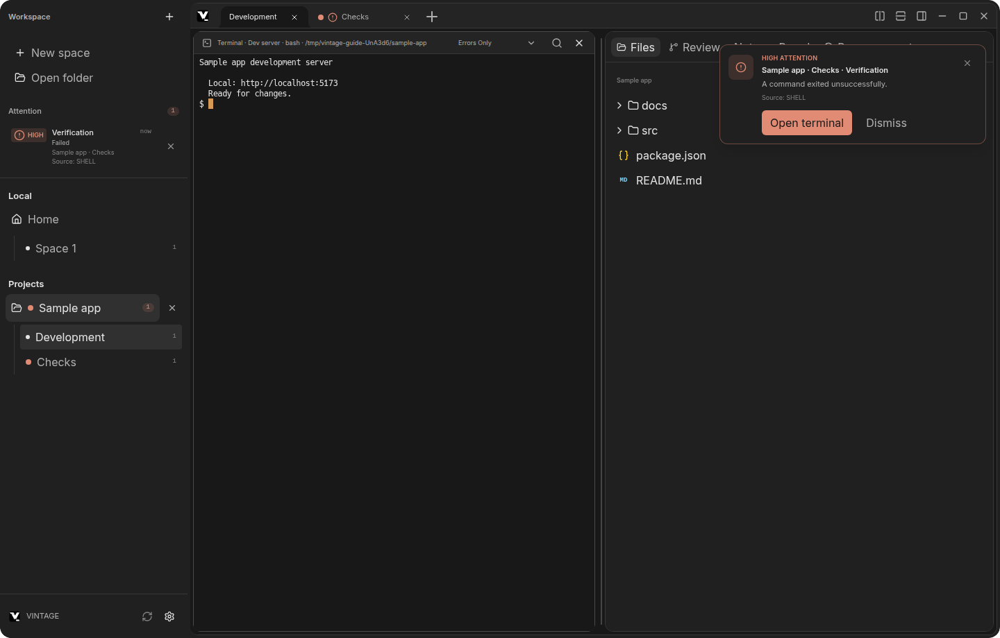
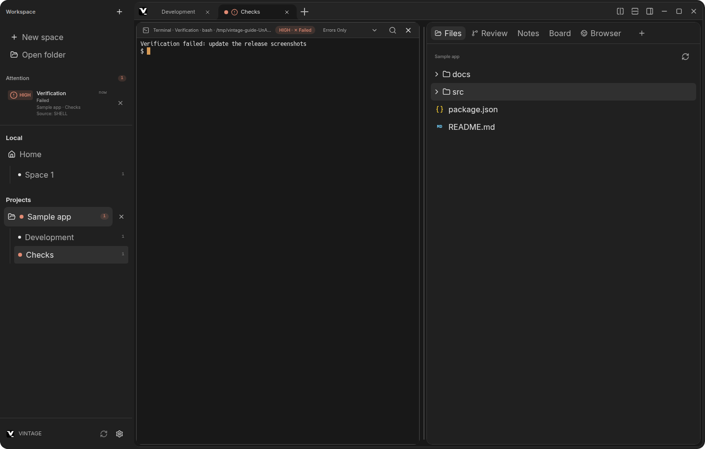
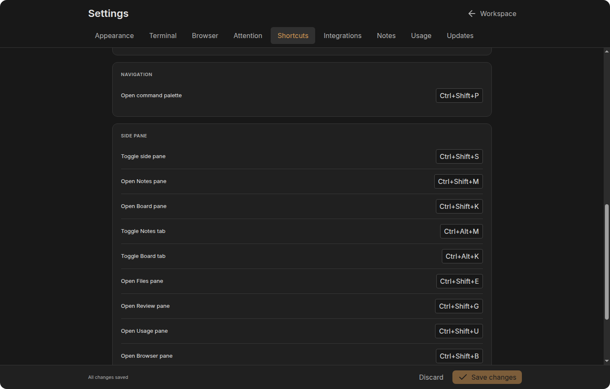
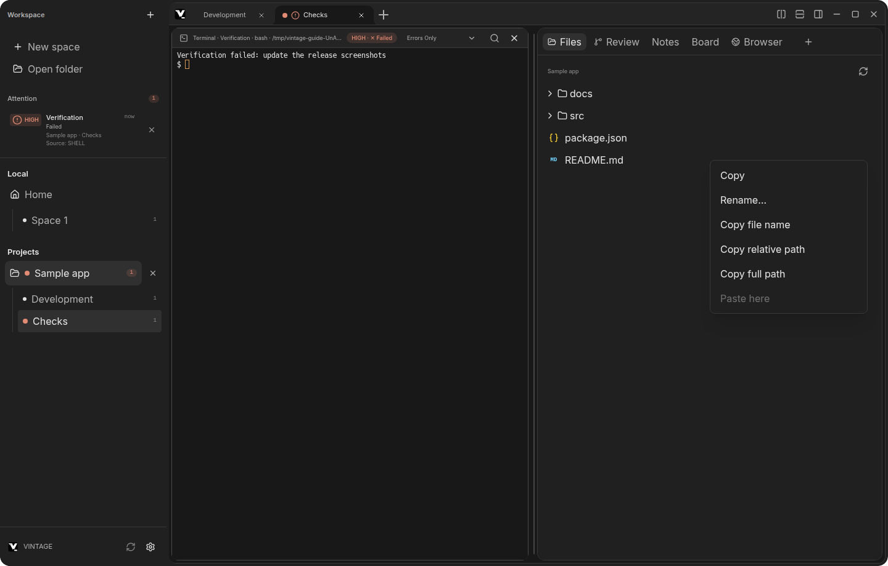
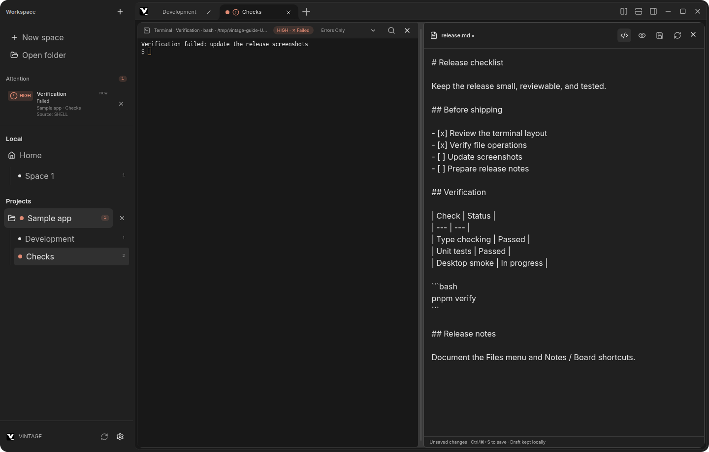
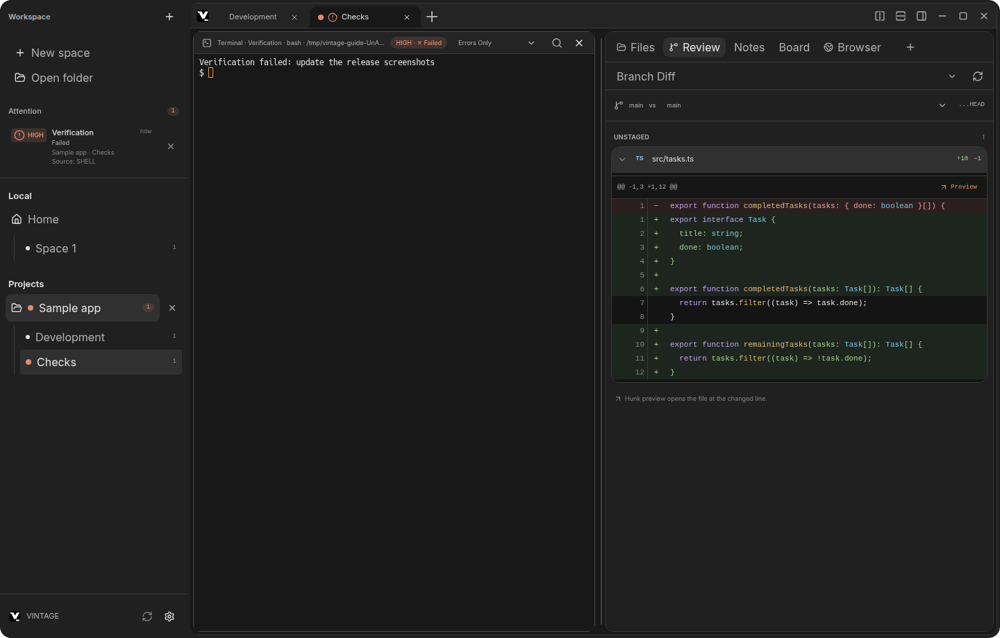
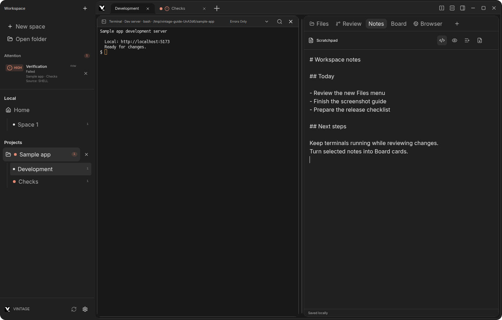
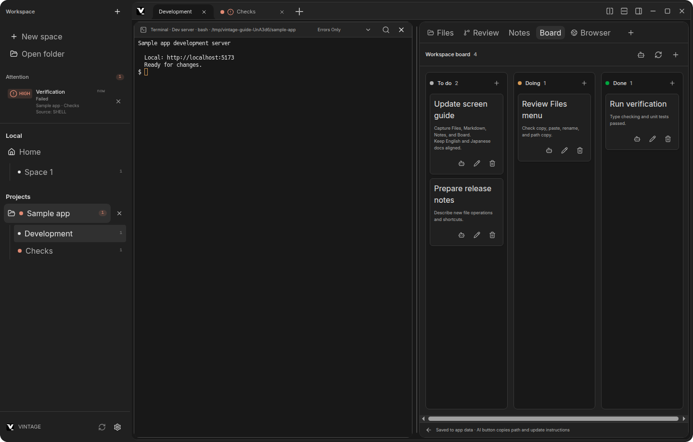
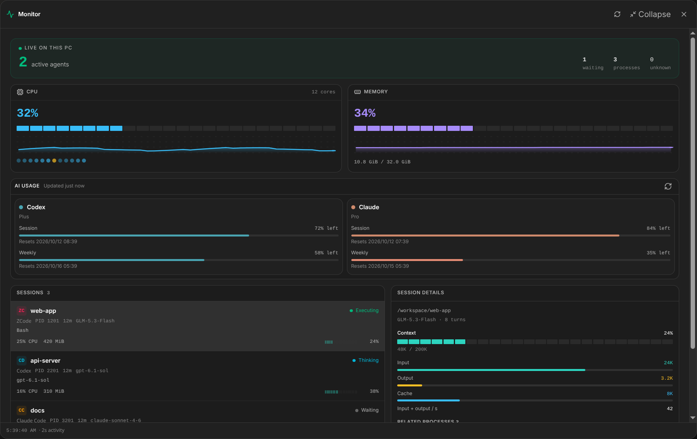

# 機能と画面

[English](FEATURES.md) | 日本語 | [README](../README_JP.md)

VINTAGEの主な画面と機能を詳しく説明します。概要とセットアップは[README](../README_JP.md)をご覧ください。

キャプチャーは現在のElectron開発版を撮影したものです。Workspace、ファイル、ターミナル出力、メモ、カードには撮影用のサンプルを使っています。

## メイン画面

VINTAGEの画面は、大きく3つの作業エリアに分かれています。

- **サイドバー**: ワークスペース、Spaceの一覧と、対応が必要なターミナルを示すAttention一覧
- **中央**: Spaceのタブとターミナルペイン。Space内のターミナルは左右または上下に分割できます。
- **右ペイン**: Files、Review、Notes、Board、Monitor、Sessions、Browserを切り替えて使えます。中央のターミナル配置はそのまま保たれます。



_別のSpaceで発生したAttention通知と、Filesペインを表示したサンプル画面です。_

### バックグラウンドのターミナルに戻る

Attention項目を選ぶと、対象のワークスペース、Space、ターミナルが開きます。通知の原因となった変更を確認するときは、Reviewペインも表示できます。



_Attention通知のOpen terminalからChecksのターミナルへ移動した画面です。_

## ワークスペース、Space、ターミナル

- 起動時にホームディレクトリで `Space 1` と `Terminal 1` が開きます。
- **Open folder** からプロジェクトを追加します。そのワークスペースで新しく作るターミナルは、選択したフォルダーを作業ディレクトリにします。
- 1つのワークスペースに複数のSpaceを作成でき、タブやショートカットで切り替えられます。新しいSpaceには `Terminal 1` が作成されます。
- アクティブなターミナルは右または下に分割できます。Spaceやペインは閉じることができます。タイトルをダブルクリックして名前を変更し、`Enter` またはフォーカス移動で確定、`Escape` でキャンセルします。
- zsh、bash、fish、またはOSの既定シェルを選べます。ターミナル出力をマウスで選択するとクリップボードへコピーします。
- 検索ショートカット(既定は `Ctrl+F`、macOSは `⌘F`)でターミナルのスクロールバックを検索でき、`Enter` / `Shift+Enter` で前後の一致箇所へ移動します。ショートカットは **Settings → Shortcuts → Terminal** から変更でき、ターミナルにフォーカスがあるときに動作します。
- ターミナルの出力は、利用可能な場合はGPU(WebGL)で描画され、利用できない場合はDOMレンダラーへフォールバックします。出力中のURLはシステムのブラウザーで開け(`http`、`https`、`mailto` のみ)、Sixel/iTerm2のインライン画像も表示されます。
- ターミナルのセッションはウィンドウの再読み込みやレンダラーのクラッシュ後も引き継がれます。ペインは動作中のセッションに再接続して直近の出力を復元し、ターミナルヘッダーに `reconnected` と表示します。アプリ自体を終了した場合はセッションは復元されず、ワークスペースやペインの配置情報だけが保存されます。

## エージェント状態をひと目で確認

SpaceタブとサイドバーのWorkspace/Tab行には、配下ペインの認識済み状態のうち、最も緊急度の高いものをドットで表示します。複数ペインがあるSpaceでは、優先度が最も高い状態を集約して表示します。青緑は `Thinking` または `Running`、緑は `Completed`、黄は `Waiting` または `Input needed`、赤橙は `Warning` または `Failed` です。中空のドットは `Waiting` と `Warning`、点滅するドットは `Thinking`、`Running`、`Input needed` を表します。`Idle` と分類できない `Unknown` にはドットを表示しません。

## コマンドパレット / クイックスイッチャー

`Ctrl+Shift+P` でコマンドパレットを開きます。1つの入力欄で操作、ワークスペース、Space、ターミナルペインを検索できます。**All**、**Actions**、**Locations** で検索対象を絞り、矢印キーで移動(各セクションの `Show N more` 行も選択でき、`Enter` で展開)、`Tab` / `Shift+Tab` でスコープを切り替え、`Enter` で選択、`Escape` で閉じます。

ショートカットは **Settings → Shortcuts** から変更できます。移動先や操作ごとに個別のキーを覚えなくても、パレットを入口にして検索できます。

## 既定のキーボードショートカット

ショートカットは **Settings → Shortcuts** から変更できます。設定の変更は自動保存されます。

| 操作                   | ショートカット |
| :--------------------- | :------------- |
| コマンドパレットを開く | `Ctrl+Shift+P` |
| 前のSpace              | `Ctrl+Shift+←` |
| 次のSpace              | `Ctrl+Shift+→` |
| 前のペイン             | `Ctrl+Shift+↑` |
| 次のペイン             | `Ctrl+Shift+↓` |
| 前のワークスペース     | `Alt+←`        |
| 次のワークスペース     | `Alt+→`        |
| 新しいSpace            | `Ctrl+Shift+N` |
| 右へ分割               | `Ctrl+Shift+D` |
| 下へ分割               | `Ctrl+Shift+T` |
| サイドバー表示切り替え | `Ctrl+B`       |
| 右ペイン表示切り替え   | `Ctrl+Shift+S` |
| Filesペインを開く      | `Ctrl+Shift+E` |
| FilesタブのON/OFF      | `Ctrl+Alt+E`   |
| Reviewペインを開く     | `Ctrl+Shift+G` |
| ReviewタブのON/OFF     | `Ctrl+Alt+G`   |
| Notesペインを開く      | `Ctrl+Shift+M` |
| NotesタブのON/OFF      | `Ctrl+Alt+M`   |
| Boardペインを開く      | `Ctrl+Shift+K` |
| BoardタブのON/OFF      | `Ctrl+Alt+K`   |
| Monitorを開く          | `Ctrl+Shift+U` |
| MonitorタブのON/OFF    | `Ctrl+Alt+U`   |
| SessionsタブのON/OFF   | `Ctrl+Alt+Y`   |
| Browserペインを開く    | `Ctrl+Shift+B` |
| BrowserタブのON/OFF    | `Ctrl+Alt+B`   |
| ターミナル内検索       | `Ctrl+F`       |
| 選択中のペインを閉じる | `Ctrl+Shift+W` |

ターミナルペイン内にフォーカスがあるときは、`Ctrl+W`でもそのペインを閉じられます。このキーはシェルへ送信しません。最後のペインを閉じると、そのSpaceも閉じます。



_Open Board pane、Toggle Notes tab、Toggle Board tabもSettings → Shortcutsから変更できます。_

## 右ペイン

右ペインにはFiles、Review、Notes、Board、Monitor、Sessions、Browserがあります。すべてのタブはSettings → Panelsで表示を切り替えられます。選択中のタブをOffにすると別の有効なタブへ移り、すべてOffなら案内を表示します。BrowserをOffにしても開いているタブは保持します。`Ctrl+Shift+S`で右ペイン全体の表示を切り替えます。各タブはコマンドパレットからも開け、ショートカットは **Settings → Shortcuts** で変更できます。

ターミナルと右ペインの境界をドラッグすると幅を調整できます。最大化時も含め、ターミナル用の領域を残しながらウィンドウ幅に応じて広げられます。指定した幅を保存し、ウィンドウを縮小すると表示幅を一時的に調整します。幅の変更中も実行中のターミナルセッションを保持します。

### Filesとファイルプレビュー

**Files** で選択中のワークスペースを閲覧できます。ファイルをダブルクリックすると、ターミナル領域の横にプレビューが開きます。

ファイルツリーは画面に見える行を描画し、フォルダの同時読み込み数を制限して、大規模なプロジェクトでも操作しやすくしています。フォルダの展開状態はプロジェクトごとに保存され、切り替え・再起動後も復元されます。

Filesを右クリックすると、ファイル・フォルダの新規作成、コピー、リネーム、削除、名前・相対パス・フルパスのコピーができます。新規作成先は、フォルダ上ならその中、ファイル上なら同じフォルダ、空白部分ならWorkspace直下です。削除は確認後にシステムのゴミ箱へ移動します（フォルダ内の項目を含みます）。ゴミ箱へ移動できない場合はエラーとなり、完全削除はしません。フォルダのメニューから貼り付けるか、空白部分を右クリックしてWorkspace直下へ貼り付けます。コピー＆ペーストはVINTAGE内専用で、フォルダや別Workspaceへのコピーにも対応します。同名の項目とシンボリックリンクはエラーになります。



_Filesの右クリックメニュー。貼り付けはFiles内で項目をコピーすると利用できます。_

- **Markdown** はワークスペース内の画像と表に対応し、**Preview** と **Edit** を切り替えられます。Preview ではリンクも動作します。相対パスのリンクはワークスペース内の別ファイルをビューアーで開き、`#見出し` へのアンカーはドキュメント内をスクロールし、HTTP(S) のリンクは内蔵 Browser で開きます(`Ctrl+クリック` / `⌘+クリック` で新しい Browser タブ)。`mailto:` は OS のメールアプリで開きます。
- **JSON** は整形表示またはソース表示、**CSV/TSV** は検索可能な表またはソース表示に対応します。
- **HTML** はスクリプトと外部リソースをブロックした隔離プレビューで表示し、ソース表示にも切り替えられます。
- **画像**にはズーム操作があります。**PDF**は組み込みビューアーで表示し、音声・動画には再生コントロールがあります。
- 一般的なソース・テキストファイルはシンタックス表示に対応します。検索、折り返し、コピー、再読み込みは形式や表示モードに応じて利用できます。
- Office文書やZIPアーカイブなど、未対応形式はOSのアプリで開けます。

テキストプレビューは最大1 MBかつ先頭10,000行までです。画像は最大10 MB、HTMLプレビューとそのCSSリソースは最大5 MBです。テキスト・コード表示とHTML・JSON・CSV/TSVのSource／Raw表示では、1 MB以下の完全なUTF-8ファイルを置換できます。Replace／Replace allは即時保存し、外部変更との競合時は上書きしません。ほかのプレビュー形式は読み取り専用です。

FilesとReviewは、右ペインの対象タブを表示している間、読み込み完了から3秒ごとに自動更新します。Filesの展開状態とReviewで選択中の差分は維持されます。右ペインを閉じるか別のタブへ移動すると定期更新は停止します。手動更新も利用できます。

Filesから開いたドキュメントも、ペインを表示している間は3秒ごとにファイルの変更を確認し、変更時だけ再読み込みします。Markdownの自動更新はPreview表示中のみです。非表示中の変更は再表示時に反映され、手動のReloadも利用できます。

文書ズームボタン、または文書上のCtrl＋マウスホイールで50〜300%に調整でき、倍率表示をクリックすると100%に戻ります。画像は既存のフィット・ズーム操作を使います。検索可能なテキスト表示では、Find in fileまたは`Ctrl+F`（macOSは`⌘F`）で検索欄を開きます。一致箇所を強調表示し、現在位置と件数を表示します。ボタンまたは`Enter`／`Shift+Enter`で前後に移動し、`Escape`で閉じます。検索は大文字・小文字を区別しない文字列検索で、プレビューの表示上限内が対象です。MarkdownのPreviewは検索のみ、EditではReplace／Replace allも利用できます。Markdownの置換結果は下書きとして保持され、Saveで保存します。

ソース・Raw表示は連続スクロールに対応し、一度に描画する範囲を最大600行に抑えています。Findはプレビューの読み込み上限内の全文を検索し、現在の表示範囲外の一致箇所へも移動します。検索を閉じても閲覧位置を維持します。極端に長い行は画面上で省略されることがありますが、Copy sourceでは読み込んだテキストをコピーできます。

#### Markdown編集

Filesから開いたMarkdownはPreview／Editを切り替えて編集できます。Editでは空行を含む行番号を表示し、見出し・リスト・強調・リンク・インラインコードと対応言語のコードブロックを色分けします。下部には現在の行・列と総行数を表示します。Go to lineボタン、現在位置のクリック、または`Ctrl+G`（macOSは`⌘G`）で指定行へ移動でき、`Enter`で確定、`Escape`でキャンセルします。Scratchpadでも同じ編集機能を使えます。行番号は折り返し・スクロール・ペイン幅の変更・ズームに追従します。Saveまたは`Ctrl+S`（macOSは`⌘S`）で保存します。外部で変更されたファイルは上書きせず、Reloadで読み直せます（編集中は破棄の確認があります）。1 MBを超えるファイルは編集できません。Previewの自動更新は未編集の文書のみで、Edit表示中と未保存の変更がある間は停止します。



_MarkdownのEdit表示。未保存の変更を示し、SaveとReloadを利用できます。_

### Git Review

**Review**は、選択中のワークスペースのGit変更を閲覧する画面です。**Review scope**で**Branch Diff / Local Changes**を切り替えられます。Branch Diffは、選択した**Base branch**との共通祖先から現在のブランチまでのコミット済み変更に加え、**Staged / Unstaged**を別々の一覧で表示します。Local Changesは、ステージ済み・未ステージの変更と未追跡ファイルを表示します。Reviewは読み取り専用で、Stage・Unstage・コミット・ファイル変更は行いません。

ファイルを選ぶと追加行と削除行を色分けした差分が開きます。大きな一覧は最大100ファイル、差分は最大200行ごとのPrevious / Nextで移動でき、表示上限を超える差分ではファイルプレビューを開けます。Hunkのプレビュー操作では変更行へ移動します。自動更新時も、可能な範囲で選択中のファイルと展開した前後の行を維持します。比較対象が変わった場合は、互換性のない表示状態をそのまま引き継がず、通知を表示します。更新ボタンによる手動再取得も利用できます。



_サンプルリポジトリの差分です。ファイル名には言語ごとのアイコンが付き、追加行と削除行を色分けして表示します。_

### Notes（メモ）

右ペインのNotes、コマンドパレットのOpen Notes pane、または`Ctrl+Shift+M`でWorkspaceのScratchpadを開けます。このショートカットはSettingsで変更できます。メモは入力時に自動保存され、Save as .mdでWorkspace内の新しいMarkdownファイルへ書き出せます（既存ファイルの上書きには対応しません）。メモとMarkdownの書きかけはアプリのローカルストレージに平文で保存され、ペインを閉じたりアプリを再起動しても復元されます。

Settings → Panels → Show Notes tab、または`Ctrl+Alt+M`でNotesのON/OFFを切り替えます（既定はOn）。Offの間はOpen Notes paneからも開きません。表示中のNotesをOffにすると別の有効なタブへ移ります。メモは保持され、設定は再起動後も維持されます。ショートカットはSettings → Shortcutsで変更できます。



_WorkspaceごとのScratchpad。入力時に自動保存され、カード作成とMarkdownへの書き出しに対応します。_

### Board（Kanban）

Boardタブ、コマンドパレットのOpen Board pane、または`Ctrl+Shift+K`でWorkspaceのKanbanボードを開きます。To do・Doing・Doneの3列で作業を管理し、カードにはラベル・タイトル・短縮したタスクID・優先度・期限・Subtaskの進捗を表示します。Notesは詳細で表示します。列の高さはカード量に合わせ、長い列は縦スクロールします。列の折りたたみと、狭いペインでの横スクロールに対応します。

タイトルまたはEditを押すと、Boardを作業領域へ拡大し、一覧を残したまま右に詳細ドロワーを開きます。端末セッションは維持されます。Title・Status・Priority・Due date・Labels・Description / Notesを編集し、**Save changes**で保存します。ラベルはEnterまたはAddで追加でき、未追加のラベル入力も保存対象です。編集のあるカードを閉じたり切り替えたりすると、破棄の確認を表示します。復帰ボタンで右ペインへ戻せます。列のAdd cardはタイトルだけを連続入力するフォーム、上部のAdd cardは詳細を開きます。

Description / Notesの下でSubtaskを入力し、Enterまたは＋で追加します。タイトルを行内で編集し、完了チェックや削除ができます。**Save changes**でAdd subtaskの未追加入力も含めて保存します。詳細とカードに完了数／総数と進捗バーを表示します。全Subtaskを完了しても親カードのStatusは変更しません。1カードに最大100項目、タイトルは各200文字までです。

検索はTitleとNotes、Filterは優先度、SortはManual・Priority・Due dateに対応し、Show doneでDone列を表示／非表示にします。検索・Filter・Sortは保存済みの手動順を変更しません。ドラッグで列移動や並べ替えができ、More actionsのMove to・Up／Downからも操作できます。ドラッグとUp／DownはManualかつ検索・優先度Filterなしの場合に使えます。カードの削除直後はUndoで戻せます。

Notesの編集画面で文章を選択し、Create card from noteアイコンを押すとカード詳細を開きます。未選択の場合はカーソルのある行を使い、元のメモは保持します。

カードはVINTAGEのアプリ保存領域にJSON形式で、Workspaceの実パスごとに保存され、再起動後に復元されます。未保存のカード下書きとBoardの検索・表示設定は再起動時に復元されません。既存version 1を読み込め、メタ情報の保存でversion 2、Subtaskの保存でversion 3へ移行します。移行前に元ファイルの完全な内容をバックアップします。旧版アプリは新形式を読めないため、[保存と移行の詳細](KANBAN.md#storage-and-version-migration)をご確認ください。

Settings → Panels → Show Board tab、または`Ctrl+Alt+K`でBoardのON/OFFを切り替えます（既定はOn）。Offの間はOpen Board paneからも開きません。表示中のBoardをOffにすると別の有効なタブへ移ります。カードは保持され、設定は再起動後も維持されます。ショートカットはSettings → Shortcutsで変更できます。

AIアイコンから、作業場所・Board JSONとAgent Skillのパス・対象・作業指示の5行をコピーします。Board全体のアイコンは検索・Filter・列の折りたたみで隠れたカードを含む**すべてのTo do**、カードのアイコンはその保存済みカードが対象です。CLI Agentに貼り付けて使い、コピー自体はAgentを起動しません。Pythonのコマンド例はSkillに記載しています。

配布用の[vintage-board Agent Skill](../skills/vintage-board/SKILL.md)はPython 3のhelperを含みます。`skills/vintage-board`フォルダー全体をAgentのSkill保存先へコピーするか、SKILL.mdを直接読ませてください。AI指示コピー時には同じSkillを`<VINTAGE userData>/kanban/skills/vintage-board`へ書き出し、その場所をコピーする指示へ含めます。helperはカードの読み取り・Status／Notes更新と、完全なIDを指定したSubtaskの追加・タイトル変更・完了／再開・削除に対応します。無関係なデータを保持し、アプリと共通のロック・atomic writeで更新します。Skillの配布だけでは別マシンのAgentにBoardデータは共有されません。

プロジェクト内にファイルや環境変数は追加しません。Boardが表示中かつアクティブな間は3秒ごとに外部変更を読み込み、編集中の下書きを保持して古い状態からの保存を拒否します。既存のローカル保存カードは初回に移行し、元のデータはバックアップとして残します。[AI連携・保存形式・Skill配布の詳細](KANBAN.md)をご覧ください。



_To do・Doing・Doneの3列と、Board全体・カードごとのAI指示コピーボタン。_

### Browser

ページ内を右クリックすると標準のコンテキストメニューが表示されます。選択文字はコピー、入力欄は元に戻す・やり直し・切り取り・コピー・貼り付け・プレーンテキスト貼り付け・全選択に対応します。リンクは新規タブ表示とURLコピー、画像は新規タブ表示・画像コピー・URLコピーができます。ページの余白では戻る・進む・再読み込みを表示し、どの対象でも要素の検証ができます。新規タブは元のタブのProject／Common所属を引き継ぎます。

組み込みBrowserはターミナルの横でWebページを表示でき、複数タブに対応しています。アドレス欄にはHTTP/HTTPSのURL、`about:blank`、ローカルの `file:///` URLを入力できます。開始ページは **Settings → Browser** で設定します。

#### タブと再起動時の復元

タブにはページタイトルを表示し、最新のURL、タブ順、ズーム倍率を保存します。VINTAGEの再起動後は選択中のBrowserタブを復元し、復元したバックグラウンドタブは選択時に読み込みます。保存したURLを開き直す仕組みで、ページのフォーム入力や戻る・進む履歴は復元しません。

タブの所属には **Common** とワークスペースがあります。

| 所属               | 表示される場所         | 用途の例                               |
| :----------------- | :--------------------- | :------------------------------------- |
| Common（共通）     | すべてのワークスペース | 共通のドキュメントや参考ページ         |
| 現在のプロジェクト | そのワークスペースのみ | 開発サーバーやプロジェクト専用のページ |

新規タブは現在のワークスペースに所属します。ワークスペースを切り替えると、そのプロジェクトのタブとCommonタブを表示し、選択状態を復元します。所属を変更するには、タブを右クリックするかBrowserの操作メニューを開き、**Tab belongs to** の **Tab scope** プルダウンでCommonまたは現在のプロジェクトを選びます。所属を変更してもページは開いたままです。この機能の導入前に保存したタブとブックマークはCommonとして引き継ぎます。

所属はタブとブックマークを整理するためのものです。Cookieとログイン状態はすべてのBrowserタブで共有し、プロジェクトごとに別のブラウザープロファイルは作りません。

#### ツールバーとブックマーク

アドレス欄の後ろには、ブックマークの星ボタン、**Bookmarks**、**Open in default browser**、Browserの操作メニューが並びます。外部ブラウザーで開くボタンはHTTP/HTTPSページで利用できます。

星ボタンで現在のページのブックマークを追加・解除します。操作メニューの **Save bookmarks in** にある **Bookmark scope** で、新しいブックマークの保存先をCommonまたは現在のプロジェクトに指定できます。**Bookmarks** にはCommonと現在のプロジェクトの両方を所属ラベル付きで表示します。名前を直接編集し、現在のタブまたは新規タブで開いたり、削除したりできます。ブックマークは再起動後も保持し、同じURLを両方の所属に個別に保存できます。

**Filter bookmarks**でブックマークを絞り込み、50件ごとの**Previous / Next**でページを移動できます。**More browser actions → Suspend background tabs**は非アクティブなBrowserページを解放します。再選択すると保存したURLを読み直し、未保存のフォーム入力やページ内の移動履歴は消去されます。Browserタブは横方向に並び、収まらない場合はパネルのヘッダーをスクロールできます。

Browserのページとツールバー内では、`Ctrl+L`でアドレス欄を選択、`Ctrl+W`でタブを閉じ、`Ctrl+Shift+T`で閉じたタブを復元できます。`Ctrl+Tab`／`Ctrl+Shift+Tab`は表示中のプロジェクトとCommonのBrowserタブを順に切り替えます。macOSではL／W／Shift+Tとズーム操作に`⌘`も使えます。最後のタブを閉じた後も右ペインにフォーカスがあれば復元できます。復元履歴はアプリ起動中の直近20件で、URL・所属・倍率を保持し、ページ内の入力や移動履歴は復元しません。リンクのホイールクリックは同じ所属のバックグラウンドタブで開き、タブのホイールクリックはそのタブを閉じます。マウスの戻る／進むボタンはWindows／LinuxのBrowser操作中に履歴を移動します。

#### ページ内検索・ズーム・開発ツール

- **Find in page**: Browserにフォーカスがある状態で `Ctrl+F`（macOSは `⌘F`）を押すか、操作メニューから開きます。検索バーには現在の一致位置と総件数を表示し、操作ボタンや `Enter`・`Shift+Enter` で一致箇所へ移動できます。`Escape` で閉じます。
- **ズーム**: ページ上のCtrl＋マウスホイール、Ctrl＋＋／－、または操作メニューから50〜300%の範囲で10%ずつ拡大・縮小できます。Ctrl＋0または倍率のクリックで100%に戻ります。倍率はタブごとに保持し、タブ切り替え時や再起動後も復元します。
- **Responsive preview**: 操作メニューから表示領域を狭くするプレビューを切り替え、ページのレイアウトを確認できます。
- **Pick element and copy selector**: 操作メニューから選び、ページの要素をクリックするとCSSセレクターをコピーします。
- **Developer tools**: 操作メニューからページの開発者ツールを開きます。Responsive previewと要素選択は、この項目の直上に並びます。

#### ローカルファイルと制限

例えば `file:///home/user/docs/index.html` を入力すると、ローカルHTMLを開けます。CSS・画像・スクリプト・相対リンクの読み込みに対応し、ローカルURLもブックマーク、開始ページ設定、再起動時の復元に使えます。表示と保存には元の `file:///` URLを使いますが、内部では一時的な `vintage-local:` URLへ自動変換し、最初に開いたHTMLの親フォルダ内だけを配信します。このコンピューター上のファイルのみが対象で、`file://server/share/page.html` のようなリモートのファイルホスト、親フォルダ外への移動、シンボリックリンク経由の範囲外アクセスは拒否します。

Browserのページはサンドボックスと分離を有効にして実行し、Node.jsやVINTAGEのデスクトップAPIは利用できません。ローカルHTMLは通常Webサイトとは別の非永続partitionで動き、HTTP(S)通信を行えません。ローカルページ上のHTTP(S)リンクは通常Browserの新しいタブで開きます。Webページからローカルファイルへの自動遷移も拒否します。Browserで開くファイルページは、スクリプトをブロックする **Files** のHTMLプレビューとは挙動が異なります。

ファイルのダウンロード、拡張機能、ログイン情報の保存には対応していません。

## Sessions

**Sessions**は、保存済みのCodex・Claude Code・OpenCode（opencode2）・Grok・Antigravityの会話を探すパネルです。Monitorの実行中プロセス一覧とは別に表示し、初期状態で有効です。**Settings → Panels**、**Ctrl+Alt+Y**（macOSは**⌘+Option+Y**）、コマンドパレットの**Toggle Sessions tab**でON/OFFできます。キーは**Settings → Shortcuts → Side pane**で変更できます。

- **探す**：初期表示は**Current project**です。**All projects**への切り替え、Agentでの絞り込み、保存済みタイトル・依頼プレビューの検索に対応します。最終更新日でまとめ、ピン留めしたSessionを先頭に表示します。ピンはローカルに保存します。
- **読む**：Sessionを選ぶと概要カードとChatを表示します。ユーザー発言は右側の吹き出し、Agentの応答はMarkdown・コードブロック・リスト・表に対応し、発言ごとにコピーできます。外部画像や埋め込みHTMLは読み込みません。HTTP/HTTPSリンクはクリック時にシステムブラウザーで開きます。
- **拡大する**：**Expand sessions**でアプリ全体に拡大します。広い表示では左に一覧、右に会話を並べ、狭い表示では**Back**で一覧へ戻ります。スクロールバーは隠しますが、スクロール操作は維持します。
- **再開する**：**Resume in new Space**は、Sessionの作業ディレクトリに対応するVINTAGEの開いているWorkspaceに新しいターミナルを追加し、既存ターミナルを維持します。MonitorがVINTAGE内の稼働中Sessionと認識している場合は**Open terminal**でその端末へ戻ります。VINTAGE外で稼働中と認識したSessionは、このパネルから重ねて再開しません。各OSに対応するCLIの導入が必要です。
- **Monitorから移動する**：詳細の**Open in Sessions**で、取得上限内に存在する対応会話を開きます。

| Agent                | ローカル履歴の取得元                                                          | 再開コマンド               |
| :------------------- | :---------------------------------------------------------------------------- | :------------------------- |
| Codex                | `$CODEX_HOME/sessions`、未設定なら`~/.codex/sessions`                         | `codex resume <id>`        |
| Claude Code          | `$CLAUDE_CONFIG_DIR/projects`、未設定なら`~/.claude/projects`                 | `claude --resume <id>`     |
| OpenCode (opencode2) | `$XDG_DATA_HOME/opencode/opencode.db` (`~/.local/share/opencode/opencode.db`) | `opencode2 --session <id>` |
| Grok                 | `~/.grok/sessions`の要約と更新ログ                                            | `grok --resume <id>`       |
| Antigravity CLI      | `~/.gemini/antigravity-cli`の会話DBとbrainログ                                | `agy --conversation <id>`  |
| Antigravity IDE      | `~/.gemini/antigravity`、`~/.gemini/antigravity-ide`                          | 閲覧のみ                   |

OpenCode 2は`session_v2`／`session_message`を読み取ります。旧形式の`session`／`message`／`part`はv2テーブルがない場合に使用します。

履歴はローカルから読み取り専用で取得します。ディレクトリ走査には上限を設け、一覧は最終更新順に最大500ログ／会話です。走査上限や読み取り不可の場合は警告を表示します。大きな会話は先頭・末尾の上限付き読み取りと最大100メッセージの抜粋表示で、検索対象はタイトルと依頼プレビューです。会話全文検索ではありません。Grok／Antigravityはログがなくてもメタデータを表示できます。内部思考やツール出力は会話から除外します。Claudeは通常起動で未設定だった`CLAUDE_CONFIG_DIR`を追加しないため、再開時に初期設定ファイルの参照先を切り替えません。

Linux・macOS・Windowsの再開経路を実装しています。Windowsの実行ファイルとnpmの`.cmd`／`.bat`に対応し、パスの大文字小文字・区切り文字の違いを吸収します。GUI起動でPATHが限られる場合に備え、ユーザー領域・npm・nvm・Homebrewなどの標準導入先も探索します。**Windows／macOSのSessions対応は試験対応で、実機確認はpendingです。**CLIの利用可否と、インストール済みアプリの更新動作は別途確認が必要です。

## Monitor



_セッションと使用量のデモデータを表示した拡大 Monitor。_

**対応OSの状況：Linuxはサポート対象です。WindowsのMonitorは試験中のプレリリース扱いで、実機試験はpendingです。macOSの実装はありますが、動作未確認です。**

Windowsでは同梱のRustヘルパーでプロセス検出とCPU／RAMを取得します。初期対象はClaude Code、Codex、OpenCodeで、他のAgentはWindows未検証です。取得できないプロセス情報や曖昧なセッションはUnknownとして扱います。Codexのログ紐付けは推定で、ターミナル判定ができないため、一部のターミナル専用ログは紐付けできません。Windowsのロードアベレージは表示しません。AI Usageは別途CodexBarの利用可否に依存します。Windowsでのビルド・開発にはRustツールチェーン（`cargo`）が必要ですが、インストーラー利用者にはRustやabtopの導入は不要です。

Monitorは常にPC全体のセッションを表示します。CPU／Memory、任意のAI Usage、セッション一覧、セッション詳細の順に並びます。Workspaceによる絞り込み、独立したUsageタブ、ホスト名、バックグラウンドサービスの欄はありません。Providerカードの幅と高さは揃えています。**Expand monitor**で拡大しても、ターミナルペインや選択中のセッションは維持します。

- **対応Agent**: LinuxのClaude Code、Codex、Antigravity、OpenCode、ZCode、Grok。AntigravityはCLIと識別可能なlanguage-serverプロセスが対象で、Codex app-server／MCPは対象外です。
- **ローカルの更新**: VINTAGEの起動中は、Monitorを閉じている間やウィンドウが非表示の間も約2秒ごとに更新します。次のプロセス一覧に存在しないものは即座に除外します。ZCodeは最終更新から1時間以上経過しても非表示になり、活動が再開すると戻ります。
- **セッション詳細**: 状態、現在のツール、モデル、コンテキスト量と容量、記録された入力・出力・キャッシュトークン、入力＋出力トークン数／秒、CPU・RAM、子プロセスを表示します。所有関係が分かる場合は、**Open terminal**でVINTAGE内の既存ターミナルへ移動できます。
- **情報源**: Claude／Codexのローカルログ、OpenCode／ZCodeの読み取り専用セッションDB、Antigravityの会話情報と上限付きトランスクリプト、Grokの `~/.grok/sessions` にある要約メタデータと更新イベントを使用します。Grokのターン単位の合計トークン数は、現在のコンテキスト量として表示しません。
- **紐付け**: 利用できる場合はプロセスが開いているファイルを優先します。Codexはログの起動元・プロセス開始時刻・作業ディレクトリ・直近の更新も照合し、一意な開始時刻の候補が最新スレッドでもある場合は待機中のターミナルを復元できます。ディレクトリによる紐付けは推定と表示し、候補が競合する場合は **Unknown** にします。リモートCodexサービスは非表示にし、紐付け不明・読み取り不可のローカルAgentは **Unknown** として表示を残します。共有ZCodeワーカーのリソースはグループで集計し、セッション選択はワーカー数によらずメッセージ・ツールの更新時刻で判断します。
- **制限**: 読み取り不可・判定が曖昧な状態は **Unknown**、未取得の値は **—** です。Claudeのコンテキスト容量はモデルに基づく推定の場合があり、他の不明な容量は推測しません。複数コアを使うプロセスのCPUは100%を超える場合があり、トークンの増分はまとめて届く場合があります。プロンプト本文・コマンド本文・ツール結果の表示、要約用モデル呼び出し、プロセス終了操作は行いません。ローカル監視にabtopや外部収集ツールは不要で、macOSではOSの `lsof` を使います。

以下のクォータ表示は、ローカルのセッション監視とは別に任意のCodexBar CLIを使用します。Monitorの表示は **Settings → Panels**、クォータの表示・更新設定は **Settings → Usage** で変更します。

### セッション状態と待機通知

Monitorを閉じていても、セッションの活動状態はSpaceとサイドバーの状態ドットに反映されます。ローカルセッションの監視はVINTAGEの起動中、ウィンドウが非表示でも約2秒ごとに継続します。CodexBarのUsage取得は引き続きMonitor表示中に行います。

**Settings → Attention → Session wait notifications**は初期状態で有効です。ThinkingまたはExecutingからWaitingへ変化すると、Attentionのトーストとデスクトップ通知で知らせます。VINTAGE内の端末に紐付かないセッションも対象です。初めて検出した時点でWaitingだったセッションは通知しません。Waitingには「応答完了」と「入力待ち」の両方が含まれ、質問への回答が必要とは限りません。

端末に紐付くセッションの**Open Space**はその端末へ移動し、紐付かないセッションはMonitorで開きます。Attentionのしきい値と端末の監視モードに従い、Muteはデスクトップ通知を抑止、Errors OnlyとIgnoreはセッションの待機通知を生成しません。デスクトップ通知にはアプリ全体の通知設定も必要で、通常はVINTAGEにフォーカスがないときに通知します。Always Notifyはフォーカスと重要度のしきい値にかかわらず通知します。セッションの待機通知だけを個別に無効化することもできます。

### Usage制限（CodexBar）

Monitor内の **AI Usage** には、AIプロバイダーごとのクォータをひと目で確認できるように表示します。使用期間（ウィンドウ）ごとの残率バー、リセット時刻（ローカル時間の `YYYY/MM/DD HH:MM` 形式）、プランとアカウント、クレジット、取得できる場合は直近のコストです。バーは普段は無色で、残率が40%・10%を下回ったときだけ警告色・危険色に変わります。リセット時刻にカーソルを合わせるとカウントダウンを確認できます。

このセクションは **Settings → Usage** で有効にするまで表示されません。[CodexBar CLI](https://github.com/steipete/codexbar) のインストールが必要です。

1. CodexBar CLIをインストールし、プロバイダーの設定を済ませて、ターミナルで `codexbar` コマンドが実行できる状態にします。
2. **Settings → Usage** で **Show Usage in Monitor** を有効にし、CodexBarを設定します。**codexbar path** を空にすると `PATH` と一般的なインストール先から自動検出し、**Browse…** で明示指定もできます。検出できたパスとバージョンは入力欄の下に表示されます。
3. 表示されるプロバイダーは `~/.config/codexbar/config.json` の有効フラグに従います。VINTAGEは `codexbar dashboard` の結果をそのまま表示します。Claude Codeを追加するには `codexbar config enable --provider claude` を実行します。

Monitorとアプリの画面が表示されている間、設定した間隔（60〜600秒、設定画面で10秒刻みで変更可能）ごとに `codexbar dashboard` を再実行します。手動更新ボタンも常時利用できます。取得に失敗したプロバイダーは、使用率の代わりにエラーを表示し、CodexBarがアイドルと印づけたウィンドウ（使用実績のないモデルファミリー）は非表示になります。クォータデータはローカルのCodexBarから取得し、VINTAGE自身がプロバイダーのAPIと通信することはありません。

## Attention監視

各ターミナル上部のメニューから監視モードを選びます。Attentionはサイドバーと履歴に表示され、モードや通知設定に応じてデスクトップ通知も送られます。項目や通知をクリックすると該当ターミナルへ移動できます。

| モード          | 動作                                                                                                                                                                                                                                                                                   |
| :-------------- | :------------------------------------------------------------------------------------------------------------------------------------------------------------------------------------------------------------------------------------------------------------------------------------- |
| `Monitor`       | 通常は出力が落ち着いたときとコマンド終了時に評価します。常時ポーリングするモードではありません。                                                                                                                                                                                       |
| `Mute`          | `Monitor` と同じように監視し、Attention一覧には表示しますが、デスクトップ通知を抑止します。                                                                                                                                                                                            |
| `Always Notify` | 重要度のしきい値やアプリのアクティブ状態にかかわらずデスクトップ通知を送ります。アプリ全体の通知設定は有効にしてください。                                                                                                                                                             |
| `Agent Monitor` | Jev設定時は作業中のAgentを定期的に評価します（基準間隔は既定10秒、5〜300秒に変更可能）。出力が変化しない間は間隔を2倍ずつ最大6倍まで延長し、出力再開で基準間隔に戻します。出力中は `Thinking` を表示し、ターン完了や入力要求を検出します。`Thinking` の表示はJev未設定でも動作します。 |
| `Errors Only`   | Jevを呼び出さず、異常終了や明らかなエラー出力を検知します。通常完了や警告はAttentionにしません。                                                                                                                                                                                       |
| `Ignore`        | このターミナルの監視とAttention通知を停止します。                                                                                                                                                                                                                                      |

`Monitor`、`Mute`、`Always Notify` は出力が落ち着いたとき（既定800 ms）とコマンド終了時に評価します。出力中のJev再評価は最短5秒間隔に制限されます。Attention一覧とデスクトップ通知のしきい値は **Settings → Attention** で調整できます。

## Jevによる意味判定

Jevは[TypeSafe JavaScript SDK](https://docs.typesafe.ai/sdk/javascript)を使う任意の連携機能です。ローカルルールでコマンドの状態を確実に判断できないとき、ターミナルの直近の出力を分類します。判定する状態は次のとおりです。

- `Completed`、`Failed`、`Waiting input`、`Waiting external`
- `Warning`、`Thinking / Busy`、`Running / Unknown`

注意度を0〜4で推定し、対応が必要かどうかも判定します。結果が曖昧な場合は、信頼できるローカル判定を優先します。Jevを利用できない場合もターミナル操作はブロックせず、ローカル判定を使います。

### 送信データとプライバシー

Jevへのリクエストには、秘密情報と思われる値をマスキングしたコマンド名、ワークスペース名、終了コード、実行時間、ターミナル出力の末尾40行（最大4,000文字）が含まれます。フルパス、環境変数、ターミナルの全スクロール履歴は送信しません。リクエストはアプリ全体で毎秒2件・毎分30件まで、タイムアウトは10秒です。

### Jevの設定

1. **Settings → Integrations** を開きます。
2. Jev APIキーを入力して保存します。

キーはKeychainやSecret ServiceなどOSの安全な資格情報ストレージで暗号化され、Rendererプロセスには渡りません。安全なストレージが利用できない場合は `TYPESAFE_API_KEY` を設定できます。保存済みキーが優先され、変更はアプリ再起動なしで実行中のターミナルにも反映されます。

判定ログを確認するには、VINTAGEを完全に終了し、`VINTAGE_JEV_DEBUG=1 pnpm dev` で起動します。ログには連携の有効状態、判定理由、評価を見送った理由が出力されますが、リクエスト本文とAPIキーは含まれません。

## 設定と保存データ

PanelsではFiles・Review・Notes・Board・Monitor・Sessions・Browserを個別にON/OFFできます。Offのタブは開くショートカットとコマンドパレットからも開きません。タブのON/OFFはSettings → Shortcutsで再割り当てでき、Filesは`Ctrl+Alt+E`、Reviewは`Ctrl+Alt+G`、Monitorは`Ctrl+Alt+U`、Sessionsは`Ctrl+Alt+Y`、Browserは`Ctrl+Alt+B`が既定です。

設定の変更は自動保存されます。不正なURLは保存しません。JevのAPIキーは、専用のSave API keyまたはClear saved key操作で保存・削除します。

設定では外観とUIサイズ、ターミナルのフォントとスクロールバック、シェル、Browser、Attention、ショートカット、Jev連携、Monitor内のUsage（CodexBar）、アップデートを調整できます。

Linuxでは、AppImageの更新はVINTAGEから適用できます。`.deb` 版では、ダウンロードした更新のインストール時にシステムの認証(`pkexec`)を一度求め、承認するとその場で適用して再起動を促します。認証に失敗した場合や利用できない場合は、従来どおりダウンロードしたパッケージをシステムのパッケージインストーラーで開くので、そこでインストールを完了してからVINTAGEを再起動してください。インストーラーが見つからない場合は、Settingsに `sudo apt install` コマンドが表示されます。

Attentionのしきい値・監視周期とターミナルごとの監視モードは、OSのユーザーデータ領域にある `attention-settings.json` に保存されます。監視モードの照合には、ワークスペースパス、Space名、ターミナル名から生成したハッシュを使います。このファイルにプロジェクトパスやログを平文で保存しません。その他のUI設定は別に保存されます。

ワークスペース、Space、ペイン配置、開いているファイルのパスは `workspace-state.json` に保存されます。復元に使うProjectのパスと相対ファイルパスが含まれます。Projectフォルダーが見つからない場合もSpace情報は保持され、フォルダーを再指定するかProjectを削除できます。ターミナルのプロセスや出力内容は保存されません。

### 外観とカスタムテーマ

**Settings → Appearance**を開きます。**Color scheme**では、配色とは独立してSystem（OSの明暗切り替えに追従）・Light・Darkを選べます。**Themes**にはVintage・Graphite・Ocean・Grove・Iris・Emberの6種類があり、丸い太陽・月のプレビューを押すとライト用・ダーク用の配色を指定できます。選択中はリングで表示され、明暗それぞれ別のテーマを使えます。配色を選んでも現在の明暗モードは維持されます。

テーマ操作はアイコンボタンで、マウスを合わせると説明が表示されます。

- **Create theme**（パレットアイコン）: 選択中のダーク用配色から編集可能なコピーを作成します。
- **Import theme**（アップロードアイコン）: VINTAGE形式のテーマJSONを読み込み、編集可能なコピーを追加します。
- **Duplicate**（各カードのコピーアイコン）: そのテーマから編集可能なコピーを作成します。

カスタムテーマのカードには**Edit / Export / Delete**が表示されます。名前・ライト用背景色・ダーク用背景色・アクセント色を編集でき、文字色と境界線の色は自動生成されます。色の変更は即時保存され、名前は入力欄からフォーカスが外れたときに保存されます。反映するにはカスタムテーマの太陽・月のプレビューを選択してください。テーマ変更時も既存の端末セッションを維持して色を更新します。選択中のカスタムテーマを削除すると、該当する明暗の配色はVintageに戻ります。

**Export**で`vintage-theme.json`をダウンロードできます。Importは、空でない`name`（60文字以内）と、6桁の16進カラーによる`light`・`dark`・`accent`を持つVINTAGE形式のJSONに対応します。例は以下のとおりです。カスタムテーマは最大100件、読み込むファイルは64 KiB以下です。テーマと明暗の選択は他のUI設定とともにローカルに保存され、再起動後も復元されます。従来のGraphite設定はダーク用の配色を引き継ぎます。

```json
{
  "name": "Nightfall",
  "light": "#f7f3fc",
  "dark": "#211b30",
  "accent": "#a180dc"
}
```
