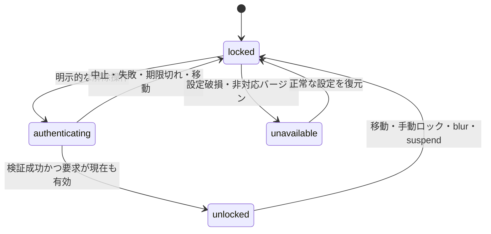

# YubiKey で解除する Private Space のアイデア

記録日・公式情報確認日: 2026-10-23

ステータス: アイデア＋詳細設計 v0.1。実装・採用は未決定。SDK の導入や実機検証は行っていない。後半に実機到着前の推奨設計を追記。

## 目的

VINTAGE の Space に「Private Space」を設定し、別の Space に移動すると自動的にロックする。戻った際は登録済み YubiKey にタッチして内容を表示する。

ブラウザのプライベートモードのように用途を分けられる体験を目指す。ただし初期案は表示へのアクセス制御であり、履歴を残さないモードや保存データの暗号化とは区別する。

ユーザー所有の YubiKey 5C NFC と Nano を想定する。Nano は正確な製品名・世代・ファームウェアを実機確認する。2 本を別々の認証器として登録し、普段用と予備用のどちらでも解除できる設計を検討する。認証資格情報を 2 本の間でコピーする前提にはしない。

## 基本の操作

1. Space のメニューから「Private Space にする」を選ぶ。
2. 初回はキーを登録し、解除できることを確認する。予備キーの登録も案内する。
3. 利用中の Private Space から別の Space へ移動すると、直ちにロックする。
4. 戻ると内容の代わりに「YubiKey にタッチして開く」を表示する。
5. 登録済みキーによる認証が成功すると、元のターミナル・ファイル・レイアウトへ戻る。

Nano を挿しっぱなしにしていても、戻るたびに新しい認証を要求する。単なる USB 接続の検出やキーボード入力として届く OTP 文字列を、解除の証拠にはしない。

| タイミング                                     | 挙動案                                    |
| ---------------------------------------------- | ----------------------------------------- |
| 別の Space へ移動                              | 移動元の Private Space を即時ロック       |
| アプリ起動・再起動                             | Private Space はロック状態で復元          |
| スリープ・OS セッションロック                  | ロックし、復帰後も認証を要求              |
| キー未接続・認証失敗・キャンセル・タイムアウト | ロックを維持し、再試行できる              |
| 手動ロック                                     | コマンドパレットと Space メニューから実行 |

アプリのフォーカス喪失、一定時間の無操作、キー取り外しでもロックするかは追加設定として検討する。複数ウィンドウで同じ Space を表示できる場合の解除範囲・ロック連動は実装前に決める。

## ロック中の処理と表示

ターミナルセッションや実行中のエージェントは維持する。ロックはプロセスの停止・終了を意味しない。

内容が別の表示経路から見えないよう、次の扱いも設計に含める。

- ターミナル出力、スクロールバック、入力欄、ファイル、プレビュー、ブラウザ表示を隠す。
- Attention と OS 通知は「プライベート Space で作業が完了しました」などに置き換え、本文・コマンド・パスを出さない。
- Sessions、Monitor、全体検索、最近使った項目、コマンドパレット、タブのタイトルやツールチップからの露出を防ぐ。
- Space 名の秘匿を設定できるよう検討する。
- ロック中の入力、コピー、検索、エクスポート、別ウィンドウへの表示要求にも同じ判定を適用する。
- 単なる画面上の覆いだけでなく、ロック中は保護対象の内容を Renderer に配信しない設計を検討する。解除中に渡した内容の回収には限界があるため、DOM・キャッシュ・アクセシビリティ経由の残存も検証する。

Sessions や Monitor のデータは Space 外の CLI・共有ファイルから取得する場合もある。どの情報が Private Space に属するかを判定できない場合の扱いは、初期実装の前に決める。隠す対象を正確に対応付けられることを、機能成立の条件とする。

## 保護する範囲

初期案の対象は、通常の VINTAGE UI 操作による内容の閲覧。ディスク上のファイル・CLI 独自の会話履歴・ログの削除や暗号化、同じ OS ユーザー権限を持つ別プロセスや管理者からの保護は保証しない。実行中のエージェントのファイルアクセスや外部通信も継続する。

「履歴を残さない」「保存データを暗号化する」は将来の独立した検討項目とする。非表示にすることと暗号化することを UI・説明文でも区別する。

## SDK・ライブラリ調査

以下は公式資料から確認した候補であり、VINTAGE での動作確認結果ではない。

### 1. libfido2 — 本実装の有力候補

Yubico 公式の C ライブラリと CLI ツール群。USB／NFC の FIDO デバイス通信、U2F／FIDO2、認証署名の検証を提供する。Linux・macOS・Windows などで動作すると記載されている。[公式概要](https://developers.yubico.com/libfido2/index.html)

VINTAGE 向けには、Electron Main から専用ネイティブヘルパーまたは Node アドオンを呼ぶ構成が候補。これは設計上の提案であり、公式の Electron 用 SDK があるという意味ではない。ヘルパーの場合は配布バイナリ、IPC、終了・キャンセル、OS ごとのアクセス権を管理する必要がある。

タッチによる User Presence（UP）と、PIN 等による User Verification（UV）は別の指定として扱える。認証応答の署名検証 API も用意されている。[UP／UV 設定](https://developers.yubico.com/libfido2/Manuals/fido_assert_set_up.html)、[署名検証](https://developers.yubico.com/libfido2/Manuals/fido_assert_verify.html)

「毎回タッチのみ」は UX の目標とし、キー側の設定・認証方式・OS によって PIN が必要になる可能性を残す。PIN 要求を回避するためにキーの既存設定を変更する設計にはしない。

Linux では hidraw／udev の権限、Windows では OS 経由と直接アクセスの差、macOS では配布・署名・実行環境を確認する。NFC は対応リーダーと OS 側の条件も必要になるため、初期検証は USB 接続で行う。

### 2. python-fido2 — 技術検証の候補

Yubico 公式の Python ライブラリ。USB の FIDO デバイスとの通信と WebAuthn のクライアント／サーバー機能を提供する。[公式リポジトリ](https://github.com/Yubico/python-fido2)

キー登録・認証・複数キーの動作を小さな試作で確かめる候補。本番アプリに同梱する場合は Python 実行環境と依存ライブラリの配布が増えるため、採用は別途判断する。

### 3. YubiKey SDK for Desktop（.NET）— 代替候補

公式の .NET 向け SDK も存在する。[公式概要](https://docs.yubico.com/yesdk/users-manual/getting-started/overview-of-sdk.html)、[更新履歴](https://docs.yubico.com/yesdk/users-manual/getting-started/whats-new.html)

Electron／TypeScript へ直接組み込む SDK ではないため、採用時は .NET ヘルパー等が必要。概要ページは Linux 対応表と古い Windows／macOS 限定の説明が混在しているため、対象バージョンの OS・CPU・FIDO2 API 対応をリリース資料と実機で再確認する。Private Space だけのために .NET 配布を追加する価値があるかも比較する。

### 4. Electron／WebAuthn — 先に小さく検証する代替経路

WebAuthn の `navigator.credentials.create()`／`get()` を使う案もある。Electron 45 には macOS のプラットフォーム認証器を設定する `app.configureWebAuthn()` が追加されている。[Electron 公式 API](https://www.electronjs.org/docs/latest/api/app#appconfigurewebauthnoptions-macos)

ただし、その API の存在は外付け YubiKey が VINTAGE の全 OS・ページ構成で使えることを保証しない。Touch ID や同期パスキーの対応と、今回の「登録済み物理キーで解除」は区別する。実際に利用する origin、secure context、RP ID、開発版と配布版の違い、外付け認証器の選択可否を検証する必要がある。

WebAuthn が成立すれば独自ネイティブ連携を減らせる可能性がある。成立しなければ libfido2 ヘルパー案を評価する。origin の問題を回避するために Web セキュリティを無効化しない。

## 認証とロック管理の設計案

- キー登録時に credential ID と公開鍵などの検証情報を保存し、秘密鍵をアプリへ取り出さない。
- 解除ごとに新しいランダム challenge を発行する。対象 Space、要求 ID、ロック世代、有効期限に結び付け、一度だけ使えるようにする。
- Main 側で登録済み credential、署名、RP ID、UP、要求した場合の UV 等を検証する。WebAuthn 経由では origin と challenge を含む client data も検証する。
- 認証開始後に別 Space へ移動、再ロック、削除、ウィンドウ終了した場合は要求を無効化する。遅れて返った成功応答で解除しない。
- Main 側をロック状態と認証結果の管理主体とし、Renderer からの「成功した」という自己申告で解除しない。IPC 呼び出し元と対象 Space へのアクセスも検証する。
- タッチ待ちは明示的な解除操作に対応させる。他のアプリの認証や別 Space の解除と混同しないよう同時要求を整理する。
- 予備キー追加、登録解除、Private Space 設定の解除も認証対象とする。

キー紛失時の回復は未決定。初期設定で予備キーを推奨し、「設定ファイルを書き換えれば戻れる」仕組みを強い保護として説明しない。表示ロックの解除手段と、将来の暗号化データの復旧手段は別に設計する。

## 初期検証と採用判断

1. 5C NFC と Nano の正確な機種・ファームウェア・既存 PIN ポリシーを確認する。既存資格情報の削除やキーのリセットは行わない。
2. Electron の実際のページ構成で外付け YubiKey の登録・認証が可能か試す。代替として libfido2 の小さなヘルパーを試作し、依存と配布コストを比較する。
3. 2 本をそれぞれ登録し、どちらでも解除でき、未登録キーでは解除できないことを確認する。
4. 毎回のタッチ、必要時の PIN、未接続、キャンセル、タイムアウト、取り外しを確認する。
5. Space 切り替え連打、認証中の移動、スリープ、再起動で意図しない解除が起きないことを確認する。
6. PTY とエージェントの処理が継続し、解除後に出力・レイアウトを復元できることを確認する。
7. Sessions・Monitor・通知・検索・プレビュー等にロック中の内容が露出しないことを確認する。
8. Linux・macOS・Windows の配布版で確認する。ビルド成功だけを物理キーの対応実績として扱わない。

最初の到達点は「1 つの Private Space、USB の登録済みキー 2 本、Space 移動によるロック、認証後の表示復元」。保存データの暗号化、秘密情報の保管庫、本番操作の承認ゲートはこの案の初期範囲に含めない。

---

# 詳細設計 v0.1（実機到着前の推奨案）

以下は実装を始めるための設計提案であり、採用済みの仕様ではない。前半のアイデアで未決定だった点は、この節の推奨案を優先して読む。アプリ本体・認証 SDK・キーの設定はまだ変更していない。

## 1. 最初に固定する設計判断

| 項目                  | 推奨案                                                      | 理由・制約                                                           |
| --------------------- | ----------------------------------------------------------- | -------------------------------------------------------------------- |
| 保護の意味            | VINTAGE の通常操作で閲覧・入力できない表示ロック            | ディスク暗号化や OS ユーザー間の隔離は別機能                         |
| 初期の単位            | 専用 Project 内の 1 Private Space                           | 既存 Project 内で公開／非公開 Space を混在させる問題を初期版から外す |
| 共有データ            | Project の Files・Review・Board・Notes も同じ保護領域にする | Space だけ隠しても同じファイルを右ペインから読めるため               |
| 通常 Project との共存 | 可能。ただし保護 root と重なる参照経路を遮断                | Home からの閲覧、親 root、同一 root、symlink 経由を含む              |
| 解除範囲              | 操作したウィンドウの選択中 Space のみ                       | 別ウィンドウまで一括解除しない                                       |
| ロック範囲            | 保護領域単位で全ウィンドウの権限を失効                      | 切り替え、手動ロック、スリープで残存表示を防ぐ                       |
| キー                  | アプリ内の共通キー登録簿。領域ごとに許可キー ID を保持      | 2 本を独立登録し、Space ごとの重複登録を避ける                       |
| キー取り外し          | 初期版のロック条件にしない                                  | 接続検知と認証を混同せず、複数キーの曖昧さを避ける                   |
| フォーカス喪失        | 初期版はロックする                                          | 離席時の露出を減らす。OS の認証ダイアログ中の遷移は別扱い            |
| 初期プラットフォーム  | Linux USB で試作し、OS ごとに検証結果を持つ                 | 他 OS の対応は配布版と実キーで確認後に有効化                         |
| Browser               | 初期版の Private Space では使用不可                         | 現在の共有 Browser をそのまま保護対象とは呼べない                    |
| 紛失時                | 予備キーを標準経路とし、初期版に UI の認証迂回を設けない    | 平文の元ファイルは残る。将来の暗号化復旧とは切り離す                 |

既存の任意 Space にロックを付ける最終 UX は維持する目標だが、初期版は「Private Project を作成 → Private Space を作成」とする。既存 Project の変換は、他の参照・開いているペイン・未保存編集を列挙して移行できる段階で追加する。フォルダの移動・コピーは自動で行わない。

## 2. 現在のコードから分かった境界

2026-10-23 の作業ツリーを確認した結果。以下のファイル名は現存するもの。

| 現在の構造                                                                                       | Private Space で必要な変更                                                                        |
| ------------------------------------------------------------------------------------------------ | ------------------------------------------------------------------------------------------------- |
| `src/renderer/App.tsx` は `workspace.tabs` を Space として扱い、非選択の `TabSurface` も保持する | `workspaceId + tab.id` を識別子として Main に登録する。`visible=false` だけでロック扱いにしない   |
| `src/main/terminalManager.ts` のセッションは owner・pane・cwd を持つ                             | Main が検証した Space／保護領域 ID を加える。cwd だけで所有を推定しない                           |
| 同ファイルは PTY 出力、Attention、プロセス情報を別々に送る                                       | 全配送経路を共通の権限判定に通す。出力だけ遮断して完了通知を漏らさない                            |
| `src/main/ptyReplayBuffer.ts` はサイズ制限付きの文字列履歴                                       | 完全な端末画面のスナップショットではない。切断位置からの再生だけでは TUI の完全復元を保証できない |
| `src/main/index.ts` の Files・Review・Board 等は workspace 単位                                  | リクエスト対象 root と保護領域の関係を Main で検査する                                            |
| `workspaceState.ts` は state version 1、Renderer のスナップショットを保存する                    | 保護設定は専用 Main 管理ストアに分離。通常の保存要求で解除・削除できないようにする                |
| `BrowserPane.tsx` と `webviewSecurity.ts` は `persist:starter-browser` を共有                    | Private 用 guest の所有権・partition・寿命を別設計するまでは利用を止める                          |
| 右 `SidePane` は Space の内側ではなくアプリ共通部分                                              | 左の Space に加えて右ペイン、検索、パレット、エラー表示も消去対象にする                           |

IPC は登録済みアプリウィンドウのメインフレームからだけ受け付け、webview・子フレーム・外部 navigation 後の sender は拒否する。sender の確認と domain の認可は別々に行う。

新規モジュール候補は `privateSpaceManager.ts`（状態と認可）、`privateSpaceStore.ts`（永続化）、`privateResourcePolicy.ts`（所属と秘匿）、`authenticatorProvider.ts`（認証方式の差の吸収）。巨大な `index.ts` に個別の条件式を増やす形は避ける。

## 3. 保護対象の所属と迂回経路

Main に `ProtectionDomain` を持ち、Space、Project の canonical root、PTY、履歴キー、preview、通知の所属を解決する。Renderer が任意の `spaceId` を渡しただけでは所属変更を認めない。

- **Project の共有データ:** 保護領域への権限がない通常 Space からは、Files・Board・Review・Notes を読めない。Workspace ID を差し替えても同じ判定にする。
- **ファイル:** `realpath` とパス要素境界で root を比較し、文字列の単純な前方一致を使わない。親フォルダの一覧にも保護 root の実名を出さない。保護 root 内から外への symlink は初期版では開かない。hard link、外部コピー、CLI が外部へ書いた内容まで自動追跡できるとは説明しない。
- **重複登録:** 同一 root、親子 root、OS ごとの大文字小文字規則を考慮する。Home 自体を無効化する代わりに、Home から保護 root 以下を辿る経路を遮断する。登録・Locate・root 変更のたびに検査する。
- **Sessions／Monitor:** PTY ID、pane ID、既知の session key、canonical cwd の対応が確認できるものだけ分類する。既存のプロセス発見結果を無条件に信用しない。
- **所属不明:** Private Project が存在する間、全体の Sessions／Monitor は「通常領域と確認できた項目」のみ返す。未分類項目は本文・タイトル・パス・件数を含めて省略する。分類できない provider はその一覧を無効化する。
- **派生情報:** コマンドパレット、履歴検索、最近使ったファイル、タイトル、ツールチップ、エラー本文も同じ domain を引き継ぐ。検索してから UI で消すのではなく、Main で応答を除外する。
- **既存の公開経路:** 初期作成時に保護 root を表示している通常ペイン・プレビューを閉じ、配信と参照を失効させてから Private として確定する。未保存編集があれば作成を中断して保存／破棄を選んでもらう。

これはアプリ内の分類規則であり、任意のファイルや会話の内容から機密性を推定する仕組みではない。一般の CLI／エージェントが領域外にコピーした情報は保護対象から外れる。

## 4. 状態機械と競合の規則

永続化するのは保護の設定であり、`unlocked` や認証中の challenge は保存しない。起動時は必ず `locked`。



状態に `domainId`, `generation`, `policyRevision` を持つ。解除権限は Main 内の `(webContentsId, spaceId, generation)` に限定する。`authenticating` は閲覧権限を持たない。複数の認証 UI が競合しないよう、アプリ全体で認証要求は 1 件とし、新しい要求には `BUSY` を返す。

ロックの順番:

1. Main が generation を増やし、解除権限と認証要求を失効させる。
2. PTY／Attention／Monitor の配送、ファイル操作、preview の読み出しを停止する。
3. Renderer に世代付きのロック通知を送り、保護画面・選択・検索・ドラフト等を隠して破棄する。保護対象が一瞬残らないよう、Space 切り替え操作側でも先にロック画面を出す。
4. UI の消去完了を確認して遷移を完了する。応答がない Renderer は保護内容を見せたまま処理を継続せず、ウィンドウを隠して再読み込みする。

非同期読み出しは開始時と返信直前の両方で権限と世代を検査する。ロック前にキューへ入った IPC 応答は Renderer でも世代を確認して捨てる。復旧後の新しい権限に古い応答を適用しない。

保存等の副作用は「Main のコミット許可判定」を境界にする。許可前にロックされた処理は中止し、既にコミットを開始した書き込みは原子的に完了させる。ロックが開始済みの外部処理を巻き戻すとは保証しない。返す結果に内容やパスを載せない。

Space 選択は単なる Renderer state 更新ではなく、Main の `activateSpace` を通す。別 Project への移動、パレット、通知クリック、Session resume も同じ入口を使う。解除成功直前に選択 Space、世代、期限、ウィンドウ生存、policyRevision を再確認してから要求を一度だけ消費する。

フォーカス喪失時は、解除済みなら即ロック。認証中に OS のダイアログへフォーカスが移る場合は閲覧権限ゼロのまま待つが、成功後も VINTAGE にフォーカスが戻り、対象 Space が選択されていることを確かめる。未選択・非フォーカスの画面を裏で解除しない。

Electron の `lock-screen`／`unlock-screen` は macOS・Windows 向けである。Linux の OS ロック検知は desktop／D-Bus 環境別の追加調査が必要。検知できるまでは blur と suspend を利用し、「Linux の画面ロックを必ず検知」とは表示しない。resume 時も再ロックし、OS ロック解除で自動解除しない。[Electron powerMonitor](https://www.electronjs.org/docs/latest/api/power-monitor)

## 5. 認証プロトコルとキー管理

### 認証方式の境界

Main の `AuthenticatorProvider` は `enroll`, `assert`, `cancel`, `capabilities` を提供する。WebAuthn と libfido2 は同じ状態機械に接続するが、応答検証を混ぜない。WebAuthn は clientDataJSON と origin を検証し、直接 CTAP を使うヘルパーは Main が生成した clientDataHash を使う。CTAP 経路でブラウザの origin 検証をしたと主張しない。

最初に WebAuthn の小さな試作を行い、外付けキーの選択、開発版／配布版の RP ID と origin、キャンセル、OS ダイアログの動作が成立するかを判定する。成立しなければ libfido2 ヘルパーへ進む。RP ID と provider は登録簿に固定し、方式変更時はキーの再登録を必要とする前提で UI を作る。

### 登録と解除

- challenge は Main の CSPRNG で 32 bytes、期限は初期値 60 秒。時刻変更の影響を避けるため、実行中の期限管理は単調時計を使う。
- 保持する要求情報: request ID、operation（unlock／add-key／remove-key／disable-private）、domain／Space、sender、generation、policyRevision、challenge、期限。要求の目的を別操作へ転用しない。
- 登録時は登録応答の challenge、RP、公開鍵形式・アルゴリズム、UP／必要時の UV を検証し、続けて新しい challenge で実際の解除を試す。両方成功してから保存する。
- 解除時は登録済み credential ID、署名、RP ID hash、UP、要求時の UV を検証する。WebAuthn では type、challenge、許可した origin、cross-origin の扱いも検査する。
- 初期対応アルゴリズムは ES256 を候補とし、実機とライブラリで検証できたものだけ許可する。未知のアルゴリズムへ自動で緩和しない。
- signCount は保存するが、常に増える前提にはしない。0 の扱い、非ゼロからの後退・重複を区別し、疑わしい応答は解除せず別キーでの確認へ案内する。
- `UP` は「触れた」ことの確認であり、所有者本人の識別ではない。挿しっぱなしの Nano を他人が触れる環境では、PIN 等の `UV` を必須にする設定を用意する。キー側の要求をアプリ都合で弱めない。

検証項目の根拠は [WebAuthn 登録・認証手順](https://www.w3.org/TR/webauthn-3/#sctn-rp-operations) と [libfido2 の assertion 検証](https://developers.yubico.com/libfido2/Manuals/fido_assert_verify.html)。これらは候補仕様であり、VINTAGE の実装が検証済みという意味ではない。

### 「YubiKey 限定」と言える条件

UI のキー名、USB 接続、AAGUID だけでは、真正な YubiKey であることを十分に証明できない。WebAuthn の `cross-platform` 指定も製造元の保証ではない。初期版の表現は「登録済みセキュリティキー」とし、YubiKey 5C NFC／Nano を検証対象とする。製造元を強制する機能が必要になった場合に、attestation の検証・信頼ルート・モデル allowlist と更新を独立した要件にする。

新規登録では外付け認証器を指定し、同期可能な credential を許す設計にしない。ただし最終的に物理キーのみを受け付けられることは採用ゲートで確認する。開発用仮想認証器の成功をその証明には使わない。

### 2 本と設定変更

1. 最初のキーを登録し、試験解除する。この段階ではまだ保護を有効化しない。
2. 予備キーも独立登録し、試験解除する。1 本で開始する選択も可能だが、紛失時のアプリ内復旧がないことを明示する。
3. 設定を原子的に保存し、対象領域を locked にして初期設定を完了する。
4. 以後のキー追加は既存の許可キーで `add-key` の認証後、新しいキーを登録する。新しいキーだけで自己承認できない。
5. キー削除・保護解除・領域削除は目的を表示した新しい認証を要求する。最後の許可キーだけを消す操作は拒否する。

共通登録簿のキー削除では、そのキーを使う全 domain を確認する。いずれかの最後のキーになる削除は拒否し、変更時は影響する全 domain の policyRevision を更新して権限・進行中の認証を失効させる。初期版では全 domain に同じ許可キー集合を適用し、domain ごとに異なる集合の管理 UI は後回しにする。

認証済みの編集権限は対象の設定変更 1 回限り。古い「追加成功」や汎用的な解除状態を管理操作の許可に使わない。登録簿からの削除と、物理キー内部の資格情報の削除は別であり、キー全体のリセットは行わない。

## 6. 永続化と設定破損

候補ファイルは Main 管理の `userData/private-space-state.json`。秘密鍵・PIN・challenge・解除状態は保存しない。

```text
schemaVersion
revision
installationId
provider + rpId + allowedOrigins（WebAuthn の場合）
keys[]: id, credentialId, publicKeyCose, algorithm, signCount,
        displayName, createdAt, lastUsedAt
domains[]: id, workspaceId, canonicalRoot, spaceIds,
            allowedKeyIds, requireUV, publicAlias
```

登録 ID と公開鍵等は秘密鍵ではないが、追跡可能な情報としてログに出さない。権限を制限した一時ファイル＋atomic rename、schema validation、サイズ上限、revision の競合検出を設ける。ファイルアクセス権は OS ごとに確認する。

通常 workspace state には「この領域は保護設定を参照する」という marker を持たせ、両ファイルの不一致ではロック扱いにする。作成時は保護ストアを先に保存し、marker の保存に失敗しても保護 root の規則を残す。解除時は承認済みの変更 journal を使って両方を更新し、途中停止からの復旧を定義する。汎用の `workspaceStateSave` で marker・保護対象 pane を削除／公開へ移動できないよう Main が差分を検査する。locked の Renderer に渡した伏せ字・省略値を保存の正本として扱わず、Main が元の保護対象メタデータを保持して公開部分の変更だけをマージする。

設定が欠けた／壊れた／将来バージョンの場合は「Private Space の設定を読み込めません」と表示する。空の登録簿として初期化して公開に戻さない。通常 Space は使えるようにする。古いアプリ版は保護設定を解釈しない可能性があるため、ダウングレード後の保護は保証しない。

保護ストアも marker も同じ OS ユーザーに書き換えられるので、これは耐改ざん機構ではない。両方の削除やバックアップへの巻き戻しを完全検出することは初期版の保証外。

## 7. PTY を止めずにロックする

必要なのは「プロセスを閉じる」と「画面から切り離す」の分離。Private のロックで現在の terminal close を呼ばない。

- Main の PTY と shell／agent は稼働を続ける。ロック中も出力を読み、メモリ上の上限付き履歴へ収集する。
- Renderer の xterm は dispose し、検索インデックス、選択文字、画像、アクセシビリティ用 DOM を破棄する。JS ヒープの確実なゼロ化は保証しない。
- Main の送信待ちバッチもロック時に破棄する。解除後は新しい attachment ID と連番で snapshot → 差分の順に配送し、重複／欠落を検出する。
- 既存の replay は文字列途中で切れるため、ANSI／alternate screen を含む正確な復元を約束しない。候補は Main の headless terminal モデル＋シリアライズで、ライブラリ採用とメモリ予算は試作で決める。
- 初期の暫定実装が上限付き replay の場合は「保持範囲の出力を復元」と明記し、TUI の画面復元試験が通るまでは製品機能として公開しない。改行・エスケープ途中の切断も試験する。
- プロセス終了時もロックを解除しない。終了コードと末尾出力を上限付き tombstone に保持し、次の解除時に終了画面を復元する。
- 長時間出力で無制限に増えないよう、端末ごとの上限に加え、全 Private 端末の合計予算を置く。超過時は古い履歴を捨て、PTY を止めない。

現在は terminal replay の上限が `1024 * 1024` だが、実装は JS の文字列 length で数えており bytes の保証ではない。新設計では計測単位とメモリ総量を明示する。

未保存の Markdown／Notes 編集はロック前の自動保存に頼らず、編集中から Main 内の bounded draft store に同期し、解除後に戻す。OS suspend の直前に保存が間に合うことを前提にしない。draft が未実装の段階では Private 内の編集機能を提供しない。

## 8. 周辺機能の具体的な扱い

| 経路                        | 初期版の挙動                                                                                                          |
| --------------------------- | --------------------------------------------------------------------------------------------------------------------- |
| 起動・復元                  | Private の実名、path、pane タイトルを Renderer に返さず、公開 alias と locked のみ返す                                |
| Files／Review／Board／Notes | domain の権限で Main が許可。ロック後のポーリングと書き込み要求は拒否                                                 |
| Preview URL                 | URL 発行時だけでなく各 protocol リクエスト時に認可。世代付きの失効可能な参照を使い、ロックで接続と view を破棄        |
| 画像・PDF・動画             | object URL、media、canvas を破棄。画像サムネイル・PDF キャッシュを通常 Space に再利用しない                           |
| OS 通知                     | Private は解除中も固定文にする。後からロックしても通知履歴に本文が残らない設計                                        |
| Attention の外部評価        | Private の端末出力を VINTAGE の外部 AI 判定へ送らない。ローカル判定に限定。ユーザーが起動したエージェントの通信は続く |
| Session の AI 分析          | Private に所属するものは初期版では不可。既存結果も通常一覧へ出さない                                                  |
| Clipboard                   | ロック中の copy／paste を拒否。過去の clipboard・OS 履歴は消去保証なし。コピー時にこの範囲を説明                      |
| Export／外部アプリで開く    | 初期版の Private では不可。外部へ渡した後にロックで回収できないため                                                   |
| Browser                     | Private 選択中は共有 Browser を表示・操作不可。既存の通常タブの状態は維持するが Private 用として流用しない            |
| ログ                        | request ID・固定エラーコード・処理時間のみ。タイトル、path、challenge、PIN、出力本文を記録しない                      |
| OS のサムネイル／画面共有   | ロック時に無地の画面へ更新。既に撮影・共有された画像を回収できるとは保証しない                                        |

将来の Private Browser は Space 別 guest 所有権と partition を持たせる。guest を存続させて DOM を保持する案と、ロックで破棄して URL から復元する案では復元品質と残存データが異なる。フォーム入力・動画再生・ダウンロード・通知・コンテキストメニュー・別窓の扱いまで決めてから追加する。

## 9. UI とエラー

ロック画面は固定 alias、鍵アイコン、主ボタン「セキュリティキーで開く」、補助文「ターミナルの処理は続いています」で構成する。待機中は「キーにタッチしてください」とキャンセルを表示し、必要時だけ PIN の案内へ進む。PIN は標準の安全な入力経路を優先し、コマンドライン引数やログに載せない。

| エラーコード案             | 表示・次の操作                                                             |
| -------------------------- | -------------------------------------------------------------------------- |
| `NO_AUTHENTICATOR`         | キーを接続して再試行                                                       |
| `NOT_ALLOWED_OR_CANCELLED` | 認証を完了できなかった旨を表示。ブラウザが原因を区別しない場合に断定しない |
| `TIMEOUT`                  | 時間切れ。新しい要求で再試行                                               |
| `UV_REQUIRED`              | このキーでは PIN 等が必要であることを表示                                  |
| `UNREGISTERED_KEY`         | 検出できた場合のみ登録済みキーを案内                                       |
| `STALE_REQUEST`            | 解除せずロック画面へ戻す                                                   |
| `BUSY`                     | 他の認証処理を終えるかキャンセル                                           |
| `CONFIG_UNAVAILABLE`       | 保護設定の復元を案内。公開状態へ落とさない                                 |
| `UNSUPPORTED_PLATFORM`     | この環境では利用できない旨を表示                                           |

新しいキーを挿しただけ、通常の Enter 入力、OTP 文字列、認証ダイアログを閉じただけでは解除しない。予備キー登録のボタンは locked 画面から既存キーの認証なしで利用できない。

## 10. 到着前に進める実装と到着後のゲート

実装・検証は未着手のため、すべて未チェック。完了時にチェックし、検証日・対象 OS／キー・結果を項目の下に記録する。

### Phase A — 実機なしで設計を検証

- [ ] `PrivateSpaceManager`、世代、sender ごとの権限、resource policy を純粋なロジックとして試作する。
- [ ] テスト専用 provider を依存注入し、遅延成功、失敗、重複応答、キャンセルを自在に発生させる。本番ビルドに fake provider や認証スキップ設定を含めない。
- [ ] 保護 root／Home／重複 Project の認可、起動時 redaction、state 保存による保護解除防止を検証する。
- [ ] renderer の detach と PTY の継続を分離し、同じ PID・session ID のまま再接続できることを確認する。
- [ ] WebAuthn の origin／RP の試作とヘルパーのプロセス境界を比較する。仮想認証器はプロトコル・UI 検証にのみ使う。

到着前に完了できるのは状態機械・UI・認可・復元設計の検証まで。キー対応、タッチ、PIN、USB 権限、OS ごとのキャンセルの成立は未検証のまま残す。

### Phase B — キー到着後の採用ゲート

- [ ] 5C NFC／Nano の機種、ファームウェア、FIDO 対応、既存 PIN ポリシーを読み取り確認する。リセットや既存 credential の削除はしない。
- [ ] それぞれ独立に登録・解除し、未登録キーを拒否する。各解除で新しい UP が必要なことを確認する。
- [ ] タッチのみ／UV 必須、PIN 誤入力、キャンセル、USB 抜去、複数キー接続を検証する。PIN の試行回数制限に達する試験は行わない。
- [ ] Linux の開発版と配布版で権限・helper パス・配布依存を検証する。macOS／Windows は別々の実機ゲートとする。
- [ ] WebAuthn が要件を満たさなければ helper を選ぶ。helper は固定パスから shell を介さず起動し、version handshake、要求 ID、応答サイズ、期限、終了コードを検査する。秘密情報を argv／環境変数へ渡さない。

### Phase C — 公開前の受け入れ試験

- [ ] **認証中に A → B → A、古い成功応答到着** — A は locked。新しい認証が必要
- [ ] **ファイル読み出し中にロック** — 応答に内容がなく、古い世代を UI が描画しない
- [ ] **Space 名変更・削除・キー削除と認証成功が競合** — 古い policyRevision の認証を拒否
- [ ] **Home、親 Project、symlink、再登録経由で同じ root を読む** — 権限のない経路は拒否
- [ ] **ロック中に PTY が大量出力／終了** — メモリ上限を維持し、解除後に保持範囲または終了画面を復元
- [ ] **全画面 TUI、ANSI 分割、画像、検索、スクロールバック** — 残存表示なし。復元の制約を試験で確定
- [ ] **ウィンドウ A を解除、B から同じ領域を要求** — B は拒否。A の権限を流用しない
- [ ] **reload／Renderer crash／アプリ再起動** — locked。再起動をまたぐ PTY 継続は保証しない
- [ ] **保存途中の強制終了・設定破損・marker 不一致** — 公開へ落とさず復元／エラーへ進む
- [ ] **通知、Sessions、Monitor、パレット、アクセシビリティ** — 固有のテスト文字列がどの経路にも残らない
- [ ] **suspend／OS lock／blur／認証ダイアログ** — サポート環境の規則どおり。未対応 OS イベントは明示

自動テストは認可と競合を中心にし、実 Electron の UI／アクセシビリティ確認、配布版、物理キー確認を別の証拠として記録する。単にユニットテストやビルドが成功したことを、Private Space 完成の判定にしない。

## 11. 実装着手時に残る選択

- [ ] WebAuthn か libfido2 helper か: 実 origin／外付けキー／配布版の試作結果で決める。
- [ ] Terminal の正確な復元: headless terminal のコストと現行機能との互換性を計測する。
- [ ] Linux OS ロックイベント: 対象 desktop を絞って検証する。
- [ ] Browser と任意の既存 Space の Private 化: 初期版後の独立した設計課題とする。
- [ ] 暗号化: 保存形式、鍵導出、復旧キー、バックアップ、外部 CLI の平文アクセスを含む別仕様を作る。今回の公開鍵認証を追加しただけで保存データが暗号化されるわけではない。
